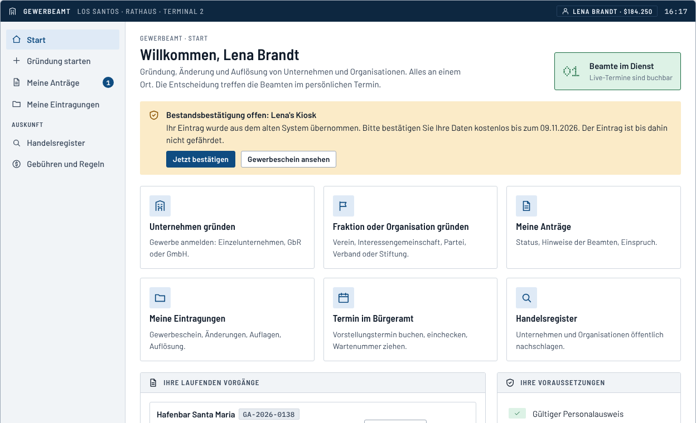
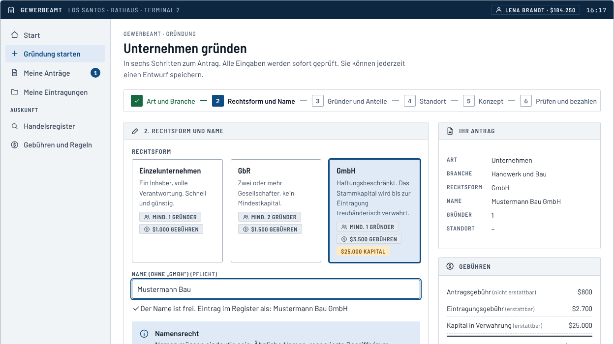
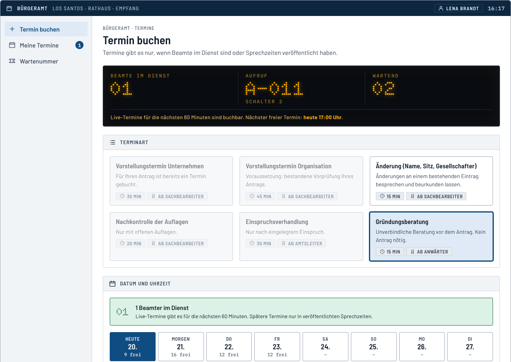
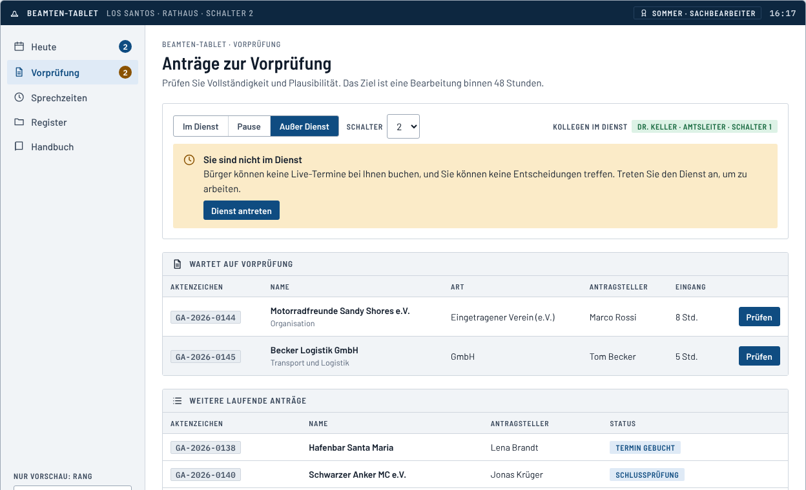

# IC-Gründung: Unternehmen und Fraktionen im Spiel gründen

**Gewerbeamt und Bürgeramt für FiveM.** Unternehmen und Fraktionen entstehen nicht mehr per Discord-Bewerbung, sondern **im Rollenspiel**:
Gründer stellen einen Antrag am Terminal, Spieler als **Beamte** prüfen ihn und entscheiden im **Vorstellungstermin**. Der Staff bleibt als Sicherheitsnetz im Hintergrund.

> **Kernregel:** Das Bürgeramt vergibt Termine **nur, wenn Beamte im Dienst sind** (oder Sprechzeiten veröffentlicht haben). Wer wartet, lässt sich benachrichtigen.

<p>
  
  
</p>
<p>
  
  
</p>

## Was ist drin?

| Teil | Wo | Stand |
|------|----|-------|
| **Konzept** mit Ablauf, Regeln, Gebühren, Rollen, Risiken | [`docs/KONZEPT.md`](docs/KONZEPT.md) | fertig |
| **Klickbare UI-Vorschau** (eine HTML-Datei, per Doppelklick) | [`vorschau/ic-behoerden-vorschau.html`](vorschau/ic-behoerden-vorschau.html) | fertig |
| **FiveM-Ressource** `ic_behoerden` (Server, Client, Oberfläche, Datenbank) | [`resources/ic_behoerden/`](resources/ic_behoerden/) | fertig, **im Spiel noch nicht getestet** |
| **Technik**: Einbau, Konfiguration, Hooks, Datenmodell, API, Sicherheit | [`docs/TECHNIK.md`](docs/TECHNIK.md) | fertig |
| **Umsetzung**: Fahrplan, Testplan, Go-live, Bestandsübernahme | [`docs/UMSETZUNG.md`](docs/UMSETZUNG.md) | fertig |
| **Beamten-Handbuch**, **Gründer-Leitfaden** | [`docs/BEAMTEN-HANDBUCH.md`](docs/BEAMTEN-HANDBUCH.md), [`docs/GRUENDER-LEITFADEN.md`](docs/GRUENDER-LEITFADEN.md) | fertig |
| **Vorlagen** für Discord-Ankündigungen | [`docs/DISCORD-ANKUENDIGUNG.md`](docs/DISCORD-ANKUENDIGUNG.md) | fertig |

## Der Ablauf in vier Zeilen

```
Gewerbeamt-Terminal           Bürgeramt                    Eintragung
─────────────────────         ───────────────────────      ──────────────────────
Antrag ausfüllen        ───►  Vorstellungstermin      ───► Registernummer
Bezahlen, Vorprüfung          Beamte prüfen und            Gewerbeschein (Item)
durch Beamte                  entscheiden                  Job, Konto, Lager über Hooks
```

- **Fraktionen** (Vereine, Clubs, Crews) gründen genauso. **Untergrund-Gruppen** melden eine legale Hülle an und geben dem Staff zusätzlich OOC-Angaben, die Beamte nie sehen.
- **Alles hat eine Begründung und einen Einspruchsweg.** Beamte sind bei eigenen Anträgen gesperrt, jede Statusänderung steht im Protokoll.
- **Verwahrung statt Verlust:** Eintragungsgebühr und Kapital werden erstattet, wenn es nicht zur Eintragung kommt. Nur die Antragsgebühr bleibt.
- **Notfallregel:** Wartet ein Antrag 72 Stunden auf einen Termin, kann der Staff nach Aktenlage entscheiden.
- **Bestandsschutz:** Bestehende Unternehmen und Fraktionen werden per Befehl (`icimport`) ins Register übernommen und bestätigen kostenlos.

## Schnellstart

1. Die Vorschau ansehen: [`vorschau/ic-behoerden-vorschau.html`](vorschau/ic-behoerden-vorschau.html) im Browser öffnen. Oben lassen sich Rollen, Beamte im Dienst und die Uhr durchschalten, links führt ein Rundgang durch den kompletten Ablauf.
2. Das [Konzept](docs/KONZEPT.md) lesen, die offenen Entscheidungen am Ende beantworten.
3. Ressource einbauen: Ordner `resources/ic_behoerden` auf den Server kopieren, in der `server.cfg` nach `oxmysql` und dem Framework starten, ACE-Recht für den Staff setzen, Orte und Beamten-Job in den Config-Dateien anpassen. Schritt für Schritt in der [Technik](docs/TECHNIK.md#2-voraussetzungen-und-installation).
4. Auf einem **Entwicklungsserver** den Testplan der [Umsetzung](docs/UMSETZUNG.md#4-phase-2-testtag-auf-dem-entwicklungsserver) durchspielen.

```cfg
ensure oxmysql
ensure es_extended          # oder qb-core / qbx_core
ensure ic_behoerden
add_ace group.admin ic_behoerden.staff allow
```

Unterstützt werden **ESX (Legacy)**, **QBCore** und **Qbox**, dazu `ox_inventory` und `ox_target` (optional). Ohne Framework läuft ein Testmodus.

## Aufbau

```
docs/                          Konzept, Technik, Umsetzung, Handbuch, Leitfaden, Vorlagen
resources/ic_behoerden/        Die FiveM-Ressource
  config.lua                   Orte und Bedienung (Client und Server)
  config_server.lua            Regeln, Gebühren, Rechtsformen, Branchen, Hooks (nur Server)
  server/  client/  shared/    Lua-Code: Fachlogik, Netzwerk, Datenbank, Brücke zu den Frameworks
  web/                         Oberfläche (HTML, CSS, JavaScript ohne Build, lokale Schriften)
  sql/install.sql              Tabellen (legt die Ressource beim Start selbst an)
  import/                      Vorlage für den Bestandsimport
  tests/                       Tests ohne FiveM
vorschau/                      Die Oberfläche als einzelne HTML-Datei
tools/                         Vorschau bauen, Schriften laden, Dokumentation prüfen
```

## Tests

```bash
cd resources/ic_behoerden
lua5.4 tests/run.lua           # 116 Tests: Logik, Datenbank, Netzwerk, Adapter, Client
node tests/ui/e2e-server.js    # Oberfläche im Browser gegen die echte Serverlogik (Node, Playwright)
node tests/ui/preview/ablauf.js  # Vorschau mit Mock-Backend (weitere Skripte im selben Ordner)
```

Oder im Hauptordner `npm test` (zuvor `npm install`). Was die Tests abdecken und was nicht, steht in der [Technik](docs/TECHNIK.md#12-tests).
Die Vorschau lässt sich mit `node tools/build-preview.js` neu bauen.

## Ehrlicher Stand

Die Fachlogik, die Datenbankschicht (auch gegen eine echte MariaDB), die Netzwerk- und Clientschicht und die Oberfläche sind getestet. **Die Anbindung an ESX, QBCore, Qbox, ox_inventory, ox_target
und die Banking-Ressourcen ist nur gegen Attrappen geprüft, die ich nach deren dokumentierten Schnittstellen gebaut habe. Im Spiel ist die Ressource noch nicht gelaufen.**
Plant einen Testtag auf einem Entwicklungsserver ein. Die Schriften unter `resources/ic_behoerden/web/fonts` stehen unter der SIL Open Font License (siehe dortige `LICENSE.txt`).
