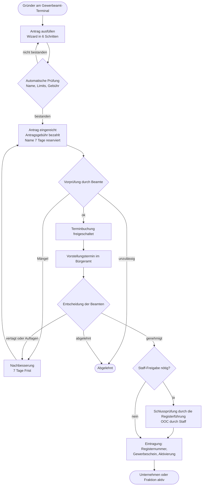
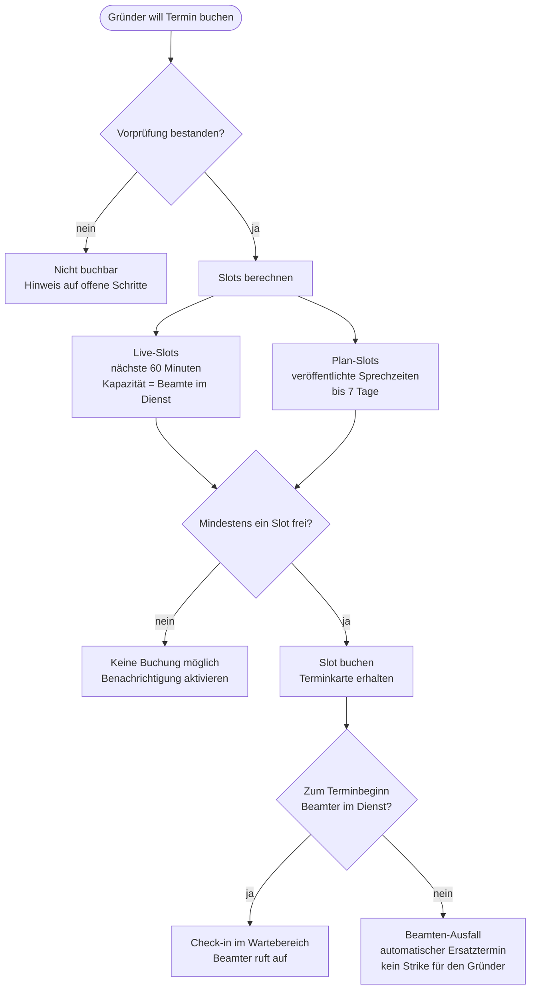

# Konzept: IC-Gründung von Unternehmen und Fraktionen

**Gewerbeamt + Bürgeramt** · Version 1.0 · Stand: Oktober 2026

> Dieses Dokument beschreibt *was* das System tut und *warum*. Die technische Umsetzung steht in
> [`TECHNIK.md`](TECHNIK.md), der Fahrplan in [`UMSETZUNG.md`](UMSETZUNG.md). Die Bedienung im Spiel
> erklären das [`BEAMTEN-HANDBUCH.md`](BEAMTEN-HANDBUCH.md) und der [`GRUENDER-LEITFADEN.md`](GRUENDER-LEITFADEN.md).
> Die klickbare UI-Vorschau öffnet sich per Doppelklick: [`../vorschau/ic-behoerden-vorschau.html`](../vorschau/ic-behoerden-vorschau.html).
> Die fertige Server-Ressource liegt in [`../resources/ic_behoerden/`](../resources/ic_behoerden/).

---

## Inhalt

1. [In 60 Sekunden](#1-in-60-sekunden)
2. [Ziele und Leitprinzipien](#2-ziele-und-leitprinzipien)
3. [Rollen](#3-rollen)
4. [Orte im Spiel](#4-orte-im-spiel)
5. [Der Gründungsablauf Schritt für Schritt](#5-der-gründungsablauf-schritt-für-schritt)
6. [Das Bürgeramt: Termine nur mit Beamten](#6-das-bürgeramt-termine-nur-mit-beamten)
7. [Der Vorstellungstermin](#7-der-vorstellungstermin)
8. [Fraktionen: Sonderregeln](#8-fraktionen-sonderregeln)
9. [Rechtsformen, Branchen, Gebühren](#9-rechtsformen-branchen-gebühren)
10. [Regeln gegen Missbrauch](#10-regeln-gegen-missbrauch)
11. [Nach der Eintragung](#11-nach-der-eintragung)
12. [Sonderfälle](#12-sonderfälle)
13. [Bestandsschutz: Was mit den bisherigen Fraktionen und Unternehmen passiert](#13-bestandsschutz)
14. [Die Rolle des Staffs (OOC)](#14-die-rolle-des-staffs-ooc)
15. [Bildschirme der Oberfläche](#15-bildschirme-der-oberfläche)
16. [Kennzahlen](#16-kennzahlen)
17. [Risiken und Gegenmaßnahmen](#17-risiken-und-gegenmaßnahmen)
18. [Offene Entscheidungen](#18-offene-entscheidungen)

---

## 1. In 60 Sekunden

**Bisher:** Fraktionen und Unternehmen entstehen OOC. Jemand schreibt eine Bewerbung, der Staff prüft sie und
legt den Eintrag an.

**Neu:** Man gründet **im Spiel**, bei einer Behörde, mit Spielern als Beamten.

```
 Gewerbeamt (Terminal)         Bürgeramt (Termin)            Eintragung
 ──────────────────────        ───────────────────────       ──────────────────────
 1. Antrag ausfüllen     ───►  4. Vorstellungstermin   ───►  7. Register-Nummer
 2. Antragsgebühr zahlen       5. Beamte prüfen und          8. Gewerbeschein (Item)
 3. Vorprüfung durch              entscheiden                9. Job/Konto/Lager werden
    Beamte                     6. Genehmigt, Auflagen,          angelegt
                                  Nachbesserung, Abgelehnt
```

Die drei wichtigsten Regeln:

| # | Regel | Wirkung |
|---|-------|---------|
| 1 | **Kein Beamter im Dienst, kein Termin.** | Das Bürgeramt gibt Termine nur heraus, wenn Beamte im Dienst sind oder Sprechzeiten veröffentlicht haben. Gründer können sich benachrichtigen lassen. |
| 2 | **Alles IC, der Staff ist das Sicherheitsnetz.** | Gründer und Beamte spielen den Prozess. Der Staff greift nur bei Kapazitätsgrenzen, Regelverstößen und Notfällen ein. |
| 3 | **Jede Entscheidung hat eine Begründung und einen Einspruchsweg.** | Beamte können nicht willkürlich ablehnen. Alles wird protokolliert. |

Was das System **nicht** tut: Es ersetzt keine Beamten. Es gibt ihnen ein Tablet, Checklisten und eine
Terminverwaltung, damit sie sich aufs Rollenspiel konzentrieren können.

---

## 2. Ziele und Leitprinzipien

### Ziele

- Mehr Rollenspiel: Gründung wird zu einer Szene mit Beamten statt zu einem Discord-Ticket.
- Beschäftigung und Sinn für die Beamten (Termine, Entscheidungen, Aufsicht).
- Weniger Arbeit für den Staff, bei besserer Kontrolle über die Serverwirtschaft.
- Nachvollziehbarkeit: Wer hat wann was entschieden und warum.
- Ein einheitliches Register, aus dem sich Unternehmen und Fraktionen im Spiel nachschlagen lassen.

### Leitprinzipien

1. **IC zuerst, OOC als Netz.** Was Spieler sehen und tun, ist Rollenspiel. OOC-Informationen (zum Beispiel
   ob eine Gruppe eine Untergrund-Fraktion ist) sehen nur Staff-Rollen, niemals Beamte.
2. **Beamte sind Spieler.** Das System spart ihnen Verwaltungsarbeit, ersetzt sie aber nicht. Ohne Beamte
   gibt es keine Termine, aber es gibt auch keinen Stillstand (siehe Notfallregel, Abschnitt 6.6).
3. **Fairness und Transparenz.** Klare Kriterien, Begründungspflicht, Einspruch, Befangenheitsregel.
4. **Kein Blockieren.** Es gibt Fristen und Eskalationen. Ein Antrag darf nicht ewig auf einen Beamten warten.
5. **Alles ist Konfiguration.** Branchen, Rechtsformen, Gebühren, Limits und Terminarten stehen in der
   Config beziehungsweise in der Datenbank, nicht im Code.
6. **Der Server entscheidet.** Die Oberfläche zeigt nur an. Jede Regel wird serverseitig erzwungen.
7. **Bestandsschutz statt Bruch.** Bestehende Fraktionen und Unternehmen werden übernommen, nicht gelöscht.

---

## 3. Rollen

| Rolle | Wer | Darf |
|-------|-----|------|
| **Gründer / Bürger** | Jeder Charakter | Anträge stellen, Termine buchen, eigene Unternehmen verwalten, das Register durchsuchen |
| **Anwärter** | Beamte in Ausbildung | Beratungstermine führen, bei Terminen zuschauen. Keine Entscheidungen. |
| **Sachbearbeiter** | Beamte | Vorprüfung, Vorstellungstermine, Entscheidungen für Unternehmen und Organisationen, Sprechzeiten veröffentlichen |
| **Amtsleiter** | Leitende Beamte | Zusätzlich: Einspruchsverhandlungen führen, Sanktionen verhängen, Sprechzeiten anderer Beamter verwalten |
| **Behördenleitung** | Spitze der Verwaltung | Dieselben Rechte wie der Amtsleiter. Eigene Befugnisse (Verordnungen: Gebühren und Limits im Spiel ändern) sind für Phase 2 vorgesehen. |
| **Staff (OOC)** | Admins und Mods | Schlussprüfung (Staff-Gate), Entscheidung nach Aktenlage (Notfallregel), Kapazitäten, Namenssperrliste, Eingriff ins Register, Audit-Log, Einstellungen |
| **Fachbehörden** | Polizei, Rettungsdienst, Justiz | Stellen Zulassungen aus (zum Beispiel für Sicherheitsdienst, Praxis, Kanzlei). Sehen das Register. |

Die Zuordnung Beamte ↔ Job und Rang steht in der Config (`Config.Officials`). Der Staff-Zugriff läuft über
ACE-Rechte (`ic_behoerden.staff`). Der Server prüft Job, Rang und Recht **bei jedem Aufruf** neu: Wer den Job verliert, kann sofort nichts mehr entscheiden.

---

## 4. Orte im Spiel

Empfehlung: **Gewerbeamt und Bürgeramt im selben Gebäude** (zum Beispiel Rathaus), damit niemand zwischen
zwei Standorten pendeln muss.

| Ort | Funktion |
|-----|----------|
| **Gewerbeamt-Terminal** | Anträge stellen, Status ansehen, Unternehmen verwalten, Register durchsuchen |
| **Bürgeramt-Empfang** | Termine buchen, einchecken, Wartenummer ziehen. Anzeigetafel mit Aufruf. |
| **Beamten-Schalter** | Hier öffnen Beamte das Tablet und führen Termine durch |

Gewerbeamt und Bürgeramt sind **ein Fenster mit zwei Startseiten**: Wer an einem der beiden Terminals sitzt, kann in der
Oberfläche zum anderen Bereich wechseln. Der Unterschied ist, wo man ins Spiel hineinläuft. Das Warten auf den Aufruf spielt
sich im Gebäude ab, dafür braucht es keine eigene Zone.

Beamte können das Tablet nur **an den Schaltern** nutzen (`Config.Locations.beamte`). Das erhält die Immersion und verhindert,
dass Entscheidungen „nebenbei“ vom Auto aus fallen. Wer das nicht will, schaltet `Config.Officials.mustBeInOffice` ab
und vergibt einen Befehl. Der Server prüft den Ort bei **jedem** Aufruf: Wer sich vom Terminal entfernt, verliert die Sitzung.

---

## 5. Der Gründungsablauf Schritt für Schritt



### Schritt 1: Antrag ausfüllen (Gewerbeamt-Terminal)

Der Wizard führt durch sechs Schritte. Bei jedem Schritt prüft der Server sofort und zeigt Hinweise an.

| Schritt | Unternehmen | Organisation | Live-Prüfung |
|---------|-------------|--------------|--------------|
| 1 | Art und Branche | Art der Organisation | Freie Plätze je Branche (Kapazität) |
| 2 | Rechtsform und Name | Name | Name frei? Zu ähnlich? Gesperrt? Rechtsformzusatz wird ergänzt |
| 3 | Gründer und Anteile | Gründungsmitglieder | Mindestanzahl Gründer, Anteile ergeben 100 %, Zustimmung der Mitgründer |
| 4 | Standort (Gewerbeimmobilie oder „mobil“) | Sitz | Standort Pflicht für manche Branchen, Immobilie noch frei? |
| 5 | Konzept: Geschäftsidee, Zielgruppe, Angebot, Personal | Zweck und Satzung, OOC-Angaben | Mindestlänge, Pflichtfelder |
| 6 | Prüfen und bezahlen | Prüfen und bezahlen | Kontostand, Voraussetzungen der Gründer, Gebührenübersicht |

**Zustimmung der Mitgründer:** Wer Mitgründer werden soll, muss **in der Nähe stehen** (15 Meter) und bekommt eine
Einladung eingeblendet. Mit **Y** nimmt er an, mit **N** lehnt er ab. Die Antwort geht direkt an den Server, der Browser des
Antragstellers kann sie nicht fälschen. Erst wenn alle zugestimmt haben, lässt sich der Antrag einreichen. So kann niemand
ungefragt als Gesellschafter eingetragen werden. Eine Einladung verfällt nach 5 Minuten, Entwürfe bleiben gespeichert.

### Schritt 2: Einreichen

- Beim Einreichen zahlt der Antragsteller **alles im Voraus**: die **Antragsgebühr** (geht sofort an die Stadtkasse und wird bei
  Ablehnung oder Rückzug **nicht** erstattet, das verhindert Spam-Anträge), die **Eintragungsgebühr** und bei GmbH und Stiftung
  das **Kapital**. Die beiden letzten bleiben **in Verwahrung** und gehen bei Ablehnung, Rückzug oder Ablauf der Frist
  **vollständig zurück**.
- Der Name ist **7 Tage reserviert** (die Frist beginnt mit jedem neuen offenen Status von vorn, solange der Antrag lebt).
- Der Antrag bekommt ein **Aktenzeichen** im Format `GA-2026-0142`.
- Ein Gründer darf höchstens **2 offene Anträge** gleichzeitig haben.

### Schritt 3: Vorprüfung (Beamte)

Ein Sachbearbeiter sieht den Antrag in der Warteschlange „Vorprüfung“ und entscheidet:

| Ergebnis | Folge |
|----------|-------|
| **Vorprüfung bestanden** | Terminbuchung wird freigeschaltet. Gründer werden benachrichtigt. |
| **Nachbesserung erforderlich** | Der Beamte schreibt, was fehlt. Der Gründer hat **7 Tage**, um den Antrag zu bearbeiten und erneut einzureichen. |
| **Abgelehnt** | Nur bei offensichtlicher Unzulässigkeit (Name, Zweck). Begründung ist Pflicht. |

Ziel-Durchlaufzeit der Vorprüfung: **48 Stunden**. Danach erscheint der Antrag im Tablet der Beamten als
„überfällig“.

### Schritt 4: Termin buchen (Bürgeramt)

Siehe Abschnitt 6. Nach bestandener Vorprüfung hat der Gründer **14 Tage** Zeit, einen Termin zu buchen.
Sonst verfällt der Antrag (Gebühr bleibt verloren, der Name wird freigegeben).

### Schritt 5: Vorstellungstermin und Entscheidung

Siehe Abschnitt 7. Die Entscheidung lautet:

| Entscheidung | Folge |
|--------------|-------|
| **Genehmigt** | Eintragung wird vollzogen (gegebenenfalls nach Staff-Freigabe). Die verwahrte Eintragungsgebühr geht an die Stadtkasse. |
| **Genehmigt mit Auflagen** | Wie genehmigt, aber mit **Auflagen** und Fristen (zum Beispiel „Mietvertrag innerhalb von 14 Tagen nachweisen“). Eine Nachkontrolle wird terminiert. |
| **Vertagt (Nachbesserung)** | Der Gründer erhält eine To-do-Liste und einen **priorisierten Folgetermin** (Fast-Lane). |
| **Abgelehnt** | Mit Begründung. Sperrfrist 24 Stunden für denselben Namen. **Einspruch innerhalb von 48 Stunden** möglich. |

### Schritt 6: Eintragung

Bei Genehmigung passiert automatisch:

1. **Registernummer** wird vergeben (`HRA 1042`, `HRB 0317`, `VR 0208`, `IG 0012`).
2. Die verwahrte **Eintragungsgebühr** geht an die Stadtkasse. Das **Stammkapital** (GmbH, Stiftung) gehört jetzt dem
   Unternehmen: Euer Hook `onApproved` bucht es auf das Firmenkonto und meldet das mit `true`. Ohne Hook geht das Kapital an
   den Antragsteller zurück. Es verschwindet nie.
3. **Gewerbeschein** (Item) wird jedem Inhaber, Geschäftsführer oder Vorsitzenden ausgehändigt. Ist er gerade offline oder das
   Inventar voll, bekommt er ihn beim nächsten Login.
4. **Aktivierung:** Das System ruft die Provisioning-Hooks auf. Dort hängt ihr eure bestehende Job-, Gang-, Konto-
   und Lagerlogik an (siehe [`TECHNIK.md`](TECHNIK.md)).
5. **Probezeit** von 14 Tagen beginnt, falls Auflagen vergeben wurden.
6. **Bekanntmachung** im Handelsregister (und optional per Discord-Webhook).

---

## 6. Das Bürgeramt: Termine nur mit Beamten

Das ist die zentrale Regel des Systems: **Termine gibt es nur, wenn Beamte da sind.**

### 6.1 Wann gibt es freie Termine?

Es gibt zwei Quellen für Termine:

| Quelle | Wann | Kapazität |
|--------|------|-----------|
| **Live-Termine** | Wenn mindestens ein passender Beamter **im Dienst** ist. Buchbar sind die nächsten **60 Minuten** im 15-Minuten-Raster. | Anzahl der Beamten im Dienst, die diese Terminart führen dürfen |
| **Sprechzeiten** | Beamte veröffentlichen Zeitfenster („Mi 20:00–22:00“). Buchbar bis **7 Tage** im Voraus. | Jede veröffentlichte Sprechzeit zählt als ein Beamter |

Gibt es weder noch, zeigt das Terminal: *„Zurzeit ist kein Beamter im Dienst. Termine sind nicht buchbar.“*
Der Gründer kann **„Benachrichtige mich“** aktivieren und bekommt eine Nachricht, sobald ein Beamter in den
Dienst geht (höchstens eine Nachricht pro 30 Minuten).



### 6.2 Terminarten

| Schlüssel | Bezeichnung | Dauer | Pflichtteilnehmer | Mindestrang des Beamten |
|-----------|-------------|-------|-------------------|--------------------------|
| `vorstellung_unternehmen` | Vorstellungstermin Unternehmen | 30 Min | Inhaber, Geschäftsführer und alle Gesellschafter ab 25 % | Sachbearbeiter |
| `vorstellung_fraktion` | Vorstellungstermin Organisation | 45 Min | Alle Gründungsmitglieder | Sachbearbeiter |
| `aenderung` | Änderung (Name, Sitz, Gesellschafter) | 15 Min | Geschäftsführer | Sachbearbeiter |
| `nachkontrolle` | Nachkontrolle der Auflagen | 20 Min | Geschäftsführer | Sachbearbeiter |
| `einspruch` | Einspruchsverhandlung | 30 Min | Geschäftsführer oder Vorstand | Amtsleiter |
| `beratung` | Gründungsberatung (ohne Antrag) | 15 Min | Beliebig | Anwärter |

### 6.3 Regeln für Buchungen

- Pro Charakter höchstens **2 offene Termine**.
- Ein Antrag hat höchstens **einen offenen Vorstellungstermin**.
- Buchung frühestens **10 Minuten** vor Beginn (Vorlaufzeit).
- **Absage** bis 15 Minuten vor Beginn ist folgenlos. Spätere Absage zählt als Strike.
- **Verschieben** ist eine Absage plus Neubuchung (die Reihenfolge ist atomar, damit der alte Slot nicht verloren geht).

### 6.4 Check-in und Aufruf

1. Das **Check-in-Fenster** reicht von 10 Minuten vor bis 10 Minuten nach Terminbeginn.
2. Gründer checken am Empfang ein und warten im Wartebereich. Der Beamte sieht, wer da ist.
3. Der Beamte ruft mit **„Aufrufen“** auf. Die Anzeigetafel zeigt Namen oder Wartenummer und Schalter.
4. Der Termin kann beginnen, sobald alle **Pflichtteilnehmer** eingecheckt sind.

### 6.5 Spontan-Besuch (Wartenummer)

Wer ohne Termin kommt, kann am Empfang eine **Wartenummer** ziehen, solange mindestens ein Beamter im Dienst
ist. Die Warteschlange wird der Reihe nach abgearbeitet. Eine Wartenummer gibt es **nur für die Beratung**. Für die
Vorstellung, die Änderung und alle anderen Termine bucht man einen Termin, denn dafür müssen Pflichtteilnehmer und Beamter
mit dem passenden Rang feststehen. Wer das Spiel verlässt, verliert seine Nummer.

### 6.6 Wenn niemand da ist: Notfallregel

Damit das System nicht stillsteht:

| Zeit ohne buchbaren Termin | Folge |
|----------------------------|-------|
| ab **72 Stunden** nach bestandener Vorprüfung | Der Antrag erscheint im Staff-Panel als **„Eskalation“** |
| danach | Der Staff kann **nach Aktenlage entscheiden** (schriftliches Verfahren). IC ist das ein Bescheid der Behörde ohne Termin. Eine Begründung ist Pflicht. Auch Sicherheits- und Finanzbranche sowie Untergrund-Fraktionen laufen danach noch durch die Schlussprüfung. |

Das schriftliche Verfahren ist **abschaltbar** (`Config.Appointments.writtenProcedure`).

### 6.7 Ausfälle und No-Shows

| Situation | Folge |
|-----------|-------|
| Beamter ist zum Terminbeginn nicht mehr im Dienst | Status **Beamten-Ausfall**. Automatischer Ersatztermin mit Vorrang, Benachrichtigung. **Kein Strike.** |
| Gründer erscheint 10 Minuten nach Beginn nicht | Beamter markiert **nicht erschienen**. 1 Strike. |
| 3 Strikes innerhalb von 14 Tagen | **3 Tage Terminsperre.** |
| Verbindungsabbruch eines Gründers | Der Beamte kann den Termin als **entschuldigt** markieren. Kein Strike. |
| Beamter bricht mitten im Termin ab (Disconnect) | Termin wird **unterbrochen** und mit Vorrang neu angesetzt. |

---

## 7. Der Vorstellungstermin

Der Gründer **stellt sein Unternehmen vor**. Das ist eine echte Rollenspielszene: Die Beamten stellen Fragen,
die Gründer erklären ihr Konzept.

### 7.1 Ablauf

1. Beamter ruft auf und begrüßt. Er öffnet das Tablet und **startet den Termin**.
2. Die Gründer stellen vor (Empfehlung: 3 bis 5 Minuten). Der Leitfaden steht im
   [Gründer-Leitfaden](GRUENDER-LEITFADEN.md).
3. Der Beamte stellt Fragen (Fragenkatalog im [Beamten-Handbuch](BEAMTEN-HANDBUCH.md)) und arbeitet die **Checkliste** ab.
4. Der Beamte notiert, wählt die **Entscheidung** und gibt eine **Begründung** ein.
5. Das System erzeugt den **Bescheid** (Dokument), druckt ihn mit Dienststempel und stellt ihn zu.
6. Bei Genehmigung wird die Eintragung ausgelöst.

### 7.2 Checkliste (Unternehmen)

- [ ] Identität aller anwesenden Gründer geprüft (Personalausweis)
- [ ] Alle Pflichtteilnehmer anwesend
- [ ] Geschäftsidee ist verständlich und für das Rollenspiel tragfähig
- [ ] Name ist zulässig (keine Verwechslungsgefahr, keine Verstöße)
- [ ] Standort ist zulässig, Mietvertrag liegt vor (falls erforderlich)
- [ ] Anteile und Rollen sind plausibel
- [ ] Zulassung der Fachbehörde liegt vor (falls die Branche sie verlangt)
- [ ] Gebühren sind bezahlt
- [ ] Gründer wurden über Pflichten belehrt (Auflagen, Probezeit, Steuern)

### 7.3 Checkliste (Organisation)

- [ ] Identität aller Anwesenden geprüft
- [ ] Mindestzahl an Gründungsmitgliedern anwesend
- [ ] Zweck und Satzung vorgetragen und zulässig
- [ ] Vorstand benannt
- [ ] Sitz oder Vereinsheim angegeben
- [ ] Name ist zulässig
- [ ] Gebühren sind bezahlt
- [ ] Belehrung über Pflichten erfolgt

### 7.4 Entscheidungsgrundsätze

**Genehmigen**, wenn alle Pflichtpunkte erfüllt sind.

**Auflagen** bei behebbaren Mängeln, die sich innerhalb einer Frist nachweisen lassen.

**Vertagen** bei fehlenden Unterlagen oder fehlenden Pflichtteilnehmern.

**Ablehnen** nur bei:

- Namensverstoß, der nicht durch Umbenennung heilbar ist
- aus IC-Sicht eindeutig unzulässigem Zweck
- bewusst falschen Angaben
- aktiver Sperre
- wiederholt fehlenden Pflichtteilnehmern

**Nie** ablehnen, weil das Konzept „nicht gefällt“, wegen Konkurrenz zum eigenen Unternehmen oder aus OOC-Gründen.
Das **Neutralitätsgebot** und die **Befangenheitsregel** stehen im Beamten-Handbuch.

### 7.5 Vier-Augen-Prinzip (Phase 2)

Für spätere Versionen ist vorgesehen, dass bestimmte Anträge (empfohlen: Fraktionen) die Gegenzeichnung eines zweiten
Beamten mit Rang Amtsleiter oder höher brauchen. Sinnvoll ab etwa fünf aktiven Beamten. Die Einstellung
`Config.Decisions.fourEyes` ist schon da, **hat in Version 1.0 aber keine Wirkung** und lässt sich im Staff-Panel nicht einschalten.

---

## 8. Fraktionen: Sonderregeln

„Fraktion“ bedeutet hier jede **Organisation**: Vereine, Parteien, Verbände, Stiftungen, Clubs und Crews.
Die Mechanik ist dieselbe wie bei Unternehmen. Es gibt andere Rechtsformen (Abschnitt 9) und Besonderheiten.

### 8.1 Legale Organisationen

| Rechtsform | Typische Beispiele | Mindestzahl Gründer |
|------------|--------------------|---------------------|
| Eingetragener Verein (e.V.) | Sportverein, Förderverein, Motorradclub | 3 |
| Interessengemeinschaft (nicht eingetragener Verein) | Clubs, Crews, Familien, lose Zusammenschlüsse | 3 |
| Partei oder Wählergemeinschaft | Politische Gruppen | 5 |
| Verband oder Gewerkschaft | Berufsverbände, Interessenvertretungen | 5 |
| Stiftung | Gemeinnützige Zwecke | 1 (plus Stiftungskapital) |

Bei Organisationen gibt es **keine Anteile**, sondern **Rollen**: Vorsitz, Stellvertretung, Kassenführung, Mitglied.

### 8.2 Untergrund-Fraktionen (Gangs, Mafia, MC, Kartell)

Illegale Gruppen melden sich IC nicht als „Gang“ an. Sie nutzen eine **legale Form als Hülle**, am
natürlichsten die **Interessengemeinschaft** oder den **Verein**. Das ist gutes Rollenspiel: Die
Polizei kann die Hülle später untersuchen.

Damit die Spielmechaniken kontrolliert bleiben, gibt es zusätzlich eine **OOC-Kennzeichnung**:

| Aspekt | Regelung |
|--------|----------|
| Eingabe | Im letzten Wizard-Schritt gibt es einen deutlich markierten Bereich **„OOC-Angaben (nur für den Staff sichtbar)“**: Fraktionsart (legal oder Untergrund), Konzept als Freitext, geplante Mitgliederzahl. |
| Sichtbarkeit | Beamte **sehen diese Angaben nie.** Das Register zeigt nur die legale Hülle. |
| Staff-Gate | Untergrund-Fraktionen brauchen nach der IC-Genehmigung eine **Schlussprüfung durch den Staff** („Registerführung“). |
| Kapazität | Untergrund-Fraktionen verbrauchen einen **Slot** der Kategorie. Sind alle Slots belegt, ist die Gründung gesperrt (Warteliste). |
| Freischaltung | Erst die Staff-Freigabe schaltet die Fraktionsmechaniken frei: Der Hook `onApproved` läuft erst nach der Schlussprüfung und bekommt `entity.ooc.category = "untergrund"`. |

**Wichtig:** Die IC-Genehmigung der Hülle bedeutet **nicht** automatisch die Freischaltung der Mechaniken. Das
ist der Hebel, mit dem ihr Gründungswellen kontrolliert.

> **Entscheidung für dich:** Wenn ihr Untergrund-Fraktionen lieber komplett OOC vergeben wollt, lässt sich
> das mit `Config.Organizations.undergroundViaPortal = false` abschalten. Dann bleibt nur der legale Weg.
> Siehe Abschnitt 18.

---

## 9. Rechtsformen, Branchen, Gebühren

Alle Werte sind **Standardwerte** und in `config_server.lua` anpassbar. Bitte an die Serverwirtschaft anpassen.

### 9.1 Rechtsformen

| Schlüssel | Rechtsform | Art | Min. Gründer | Antragsgebühr | Eintragungsgebühr | Kapital (Treuhand) | Register |
|-----------|------------|-----|-------------:|--------------:|------------------:|-------------------:|----------|
| `einzel` | Einzelunternehmen | Unternehmen | 1 | $250 | $750 | – | HRA |
| `gbr` | GbR | Unternehmen | 2 | $400 | $1.100 | – | HRA |
| `gmbh` | GmbH | Unternehmen | 1 | $800 | $2.700 | $25.000 | HRB |
| `ev` | Eingetragener Verein | Organisation | 3 | $300 | $900 | – | VR |
| `ig` | Interessengemeinschaft | Organisation | 3 | $200 | $600 | – | IG |
| `partei` | Partei / Wählergemeinschaft | Organisation | 5 | $500 | $1.500 | – | VR |
| `verband` | Verband / Gewerkschaft | Organisation | 5 | $500 | $1.500 | – | VR |
| `stiftung` | Stiftung | Organisation | 1 | $800 | $2.200 | $50.000 | VR |

Beispielrechnung: Ein Einzelunternehmen kostet **$1.000** an Gebühren, eine GmbH **$3.500** plus $25.000 Kapital.

Weitere Gebühren: Änderung $200, Duplikat des Gewerbescheins $100, Branchenfaktor (siehe unten).

### 9.2 Branchen (Unternehmen)

| Schlüssel | Branche | Standort Pflicht | Fachbehörde | Staff-Gate | Kapazität | Faktor |
|-----------|---------|:----------------:|-------------|:----------:|----------:|-------:|
| `gastro` | Gastronomie (Restaurant, Bar, Club, Café) | ja | – | – | 12 | 1,0 |
| `handel` | Einzelhandel und Shops | ja | – | – | 10 | 1,0 |
| `kfz` | Fahrzeuge und Werkstatt | ja | – | – | 6 | 1,0 |
| `transport` | Transport und Logistik | nein | – | – | 6 | 1,0 |
| `handwerk` | Handwerk und Bau | nein | – | – | 8 | 1,0 |
| `medien` | Medien und Unterhaltung | ja | – | – | 4 | 1,0 |
| `sicherheit` | Sicherheit und Detektei | ja | Polizei | ja | 3 | 1,5 |
| `gesundheit` | Gesundheit und Wellness | ja | Rettungsdienst | – | 4 | 1,0 |
| `immobilien` | Immobilien und Makler | ja | – | – | 3 | 1,0 |
| `recht` | Recht und Beratung | ja | Justiz | – | 3 | 1,0 |
| `finanz` | Finanzdienstleistungen | ja | – | ja | 2 | 2,0 |
| `sonstige` | Sonstiges | nein | – | ja | 5 | 1,0 |

**Kapazität** ist die Höchstzahl gleichzeitig aktiver Unternehmen der Branche. Sie begrenzt Überangebot und
macht freie Plätze zu etwas Wertvollem. Der Staff pflegt die Zahlen im Panel.

**Fachbehörde:** Die Zulassung (zum Beispiel ein Schreiben der Polizei für einen Sicherheitsdienst) ist ein
**Punkt auf der Beamten-Checkliste**. Das ist eine bewusste Brücke zu den Staatsfraktionen: Gründer müssen sich
IC darum kümmern.

### 9.3 Geldfluss

Alle Gebühren gehen an die **Stadtkasse** (`Config.Treasury`). Aus ihr zahlt die Verwaltung eine
**Terminpauschale** von **$150** je durchgeführtem Termin an den Beamten, **unabhängig vom Ergebnis**.
So lohnt sich das Erscheinen im Dienst, ohne dass es einen Anreiz zum Genehmigen gibt. Ist die Kasse einmal leer, wird die
Pauschale trotzdem gezahlt und im Protokoll vermerkt.

| Betrag | Beim Einreichen | Bei Genehmigung | Bei Ablehnung, Rückzug, Ablauf |
|--------|-----------------|-----------------|--------------------------------|
| Antragsgebühr | wird gezahlt, geht an die Stadtkasse | bleibt dort | bleibt dort |
| Eintragungsgebühr | wird gezahlt, liegt in Verwahrung | geht an die Stadtkasse | wird erstattet |
| Kapital (GmbH, Stiftung) | wird gezahlt, liegt in Verwahrung | geht aufs Firmenkonto (Hook) oder zurück an den Antragsteller | wird erstattet |
| Terminpauschale | | $150 an den Beamten, aus der Stadtkasse | $150 an den Beamten, aus der Stadtkasse |

Ist der Antragsteller bei einer Erstattung offline, wird sie gemerkt und beim nächsten Login ausgezahlt.

---

## 10. Regeln gegen Missbrauch

### 10.1 Voraussetzungen für Gründer

| Prüfung | Standard |
|---------|----------|
| Personalausweis vorhanden | ja |
| Mindest-IC-Alter | 18 |
| Mindest-Spielzeit des Charakters | 10 Stunden |
| Keine aktive Terminsperre oder Gründungssperre | ja |
| Höchstens aktive Unternehmen als Inhaber oder Geschäftsführer | 2 |
| Höchstens Organisationen als Gründer oder Vorstand | 1 |
| Höchstens offene Anträge | 2 |

### 10.2 Namensrecht

- 3 bis 40 Zeichen. Erlaubt: Buchstaben (inklusive Umlaute), Ziffern, Leerzeichen, `& - ' .`
- Der **Rechtsformzusatz** wird automatisch ergänzt (GmbH, e.V., GbR).
- **Normalisierung:** Kleinschreibung, Umlaute aufgelöst, Leetspeak entfernt, Leerzeichen und Satzzeichen
  gestrichen, Rechtsformzusatz abgezogen. Damit wird „Pizza-Haus“ als dasselbe wie „PIZZA HAUS GmbH“ erkannt.
- **Ähnlichkeitsprüfung:** Edit-Distanz ≤ 2 gilt als zu ähnlich (blockiert bei Treffern, Warnung bei knappen Treffern).
- **Sperrliste:** Staatsfraktionen (Polizei, Rettungsdienst, Feuerwehr, Regierung, Justiz …), Staff-Begriffe,
  Beleidigendes, verfassungsfeindliche Symbolik, konfigurierte Marken. Der Staff pflegt sie.
- **Reservierung:** 7 Tage ab Einreichung. Danach oder bei Ablehnung wird der Name frei.

### 10.3 Sperren und Strikes

| Auslöser | Folge |
|----------|-------|
| Ablehnung | 24 Stunden Sperre für denselben Namen |
| Auflösung eines Unternehmens | 7 Tage Sperre für denselben Namen |
| No-Show | 1 Strike (verfällt nach 14 Tagen) |
| 3 Strikes | 3 Tage Terminsperre |

### 10.4 Kapazitäten

Der Staff legt Obergrenzen fest: pro Branche, für Untergrund-Fraktionen und für Organisationen insgesamt.
Das Terminal zeigt freie Plätze an („3 von 8 frei“).

### 10.5 Beamte: Regeln für Entscheidungen

- **Begründungspflicht** bei Auflagen, Vertagung und Ablehnung.
- **Befangenheit:** Ein Beamter darf keinen Antrag bearbeiten, in dem er selbst als Gründer, Gesellschafter oder
  Mitglied steht. Das System sperrt das automatisch. Zusätzlich gibt es „Befangenheit melden“ (zum Beispiel
  bei Verwandtschaft oder Konkurrenz im Rollenspiel).
- **Einspruch:** 48 Stunden nach Ablehnung. Ein Amtsleiter prüft.
- **Protokoll:** Jede Statusänderung steht im Audit-Log (wer, wann, von welchem Status auf welchen, warum).

IC-Korruption (zum Beispiel Bestechung) ist eine Frage eurer Serverregeln. Das System liefert dafür die
Protokolle, mit denen Justiz oder Dienstaufsicht im Rollenspiel ermitteln können.

---

## 11. Nach der Eintragung

### 11.1 Status einer Organisation

| Status | Bedeutung |
|--------|-----------|
| `aktiv` | Eingetragen und in Ordnung |
| `probezeit` | Erste 14 Tage, wenn Auflagen vergeben wurden. Nachkontrolle wird terminiert. |
| `ruhend` | Zeitweise stillgelegt (zum Beispiel auf Antrag oder nach Bestandsschutz-Frist) |
| `gesperrt` | Gewerbeuntersagung. Keine Geschäfte, Eintrag bleibt sichtbar. |
| `aufgeloest` | Beendet. Name nach 7 Tagen wieder frei. |

### 11.2 Auflagen

Eine **Auflage** ist eine Pflicht mit Frist (zum Beispiel „Mietvertrag vorlegen bis 03.11.“). Sie wird in der Akte
geführt. Erfüllung wird im Nachkontrolltermin bestätigt. Unerfüllte Auflagen führen zu **Sanktionen**.

### 11.3 Sanktionsstufen (Amtsleiter)

1. Verwarnung
2. Bußgeld
3. Neue Auflage mit Frist
4. Befristete Gewerbeuntersagung (Status `gesperrt`)
5. Entzug und Löschung (nur mit Begründung und Einspruchsmöglichkeit, bei Fraktionen mit Staff-Kenntnis)

Jede Stufe braucht eine Begründung und lässt sich per Einspruch anfechten.

### 11.4 Änderungen und Auflösung

| Vorgang | Weg | Gebühr |
|---------|-----|--------|
| Namensänderung, Sitzverlegung | Änderungsantrag am Terminal, die Beamten vollziehen ihn im Termin `aenderung` | $200 |
| Duplikat Gewerbeschein | Terminal | $100 |
| Auflösung | Der Inhaber löst am Terminal selbst auf (sofort, ohne Termin) | – |

### 11.5 Gewerbeschein und Verlängerung

Der Gewerbeschein ist **90 Tage** gültig. Verlängerung am Terminal gegen kleine Gebühr, solange keine Auflagen
offen sind und das Unternehmen aktiv war. (Phase 2, siehe [`UMSETZUNG.md`](UMSETZUNG.md).) Wer nicht verlängert,
wird `ruhend`.

---

## 12. Sonderfälle

| Fall | Behandlung |
|------|------------|
| **Mitgründer stimmt nicht zu** | Er verschwindet aus der Liste, der Antragsteller kann ihn erneut einladen oder jemand anderen wählen. Die Einladung verfällt nach 5 Minuten. Der Entwurf bleibt gespeichert. |
| **Name wird während des Antrags anderweitig beantragt** | Nicht möglich, die Reservierung schützt den Namen. |
| **Gründer wechselt Charakter oder Server startet neu** | Anträge, Termine und Reservierungen sind in der Datenbank. Nichts geht verloren. |
| **Zwei Beamte wollen denselben Termin** | Wer den Termin zuerst startet, führt ihn. Der andere kann nicht eingreifen. |
| **Beamter ist selbst Gründer** | Befangen. Das System zeigt ihm den Antrag nicht zur Bearbeitung. |
| **Gründer verliert Ausweis** | Voraussetzungsprüfung scheitert. Hinweis im Terminal. |
| **Alle Beamten sind lange offline** | Notfallregel (Abschnitt 6.6). |
| **Gründer stirbt oder ist nicht erreichbar** | Die Frist läuft weiter. Der Beamte kann den Termin als entschuldigt markieren. |
| **Gesellschafter scheidet aus** | Änderungsantrag. Bleibt kein Geschäftsführer, wird die Organisation `ruhend`. |
| **Unternehmen wird insolvent** | Der Staff oder die Verwaltung setzt es auf `aufgeloest`. Das ist eine RP-Entscheidung. |

---

## 13. Bestandsschutz

Sobald die IC-Gründung startet, sind **neue** Fraktionen und Unternehmen nur noch über das Gewerbeamt
möglich. Bestehende bleiben bestehen.

| Phase | Was passiert |
|-------|--------------|
| **Stichtag** | Neugründungen laufen nur noch IC. Das alte Bewerbungsformular beziehungsweise Ticketsystem wird geschlossen. |
| **Übernahme** | Der Staff trägt alle bestehenden Fraktionen und Unternehmen mit dem Konsolenbefehl `icimport` ins Register ein (Datei `import/legacy.json`, siehe [`TECHNIK.md`](TECHNIK.md)). Registernummer und Gewerbeschein werden vergeben, Status `aktiv`. Der Befehl lässt sich gefahrlos wiederholen. |
| **Bestätigung** | Inhaber bestätigen ihre Daten kostenlos am Terminal („Bestandsbestätigung“) innerhalb von **28 Tagen**. Das Terminal weist dauerhaft darauf hin. |
| **Erinnerung** | Nach 14 Tagen bekommen die Inhaber **eine** Nachricht. |
| **Nach Fristablauf** | Standard: Hinweis, **keine Sanktion**. Optional: Status `ruhend` nach 56 Tagen (`Config.Legacy.restAfterDays`). Wer danach noch bestätigt, ist sofort wieder aktiv. Diese Härte ist eine Entscheidung (Abschnitt 18). |

Bestandsschutz-Einträge müssen **keinen** Vorstellungstermin durchlaufen und zahlen keine Gründungsgebühren.

---

## 14. Die Rolle des Staffs (OOC)

Der Staff tritt im Prozess nicht als Spielfigur auf. Er arbeitet im **Staff-Panel**:

| Aufgabe | Zweck |
|---------|-------|
| **Schlussprüfung (Staff-Gate)** | Nach IC-Genehmigung: Untergrund-Fraktionen und sensible Branchen. Der Staff prüft OOC-Kriterien (Konzept, Mitgliederzahl, Alt-Hinweis, Slot) und gibt frei oder weist zurück. IC heißt das „Schlussprüfung der Registerführung“. |
| **Kapazitäten** | Obergrenzen je Branche und Kategorie setzen |
| **Namenssperrliste** | Begriffe sperren oder freigeben |
| **Eskalationen** | Überfällige Anträge, Notfallregel (nach Aktenlage entscheiden) |
| **Audit-Log** | Alle Statusänderungen einsehen und filtern |
| **Register-Eingriff** | Eintragungen auf `aktiv`, `ruhend`, `gesperrt` oder `aufgeloest` setzen. Immer mit Begründung und im Audit-Log. Die Inhaber erfahren IC nur, dass „die Registerführung“ gehandelt hat. |
| **Einstellungen** | Funktionen ein- und ausschalten (Notfallregel, Beamtenpflicht, Untergrund-Weg) |

**Grundsatz:** Der Staff greift ein, wenn Regeln verletzt werden oder Kapazitäten ausgeschöpft sind, nicht weil
ihm ein Konzept nicht gefällt. Wo er ablehnt, nennt er einen OOC-Grund, der dem Gründer verständlich mitgeteilt wird
(ohne IC-Bezug).

---

## 15. Bildschirme der Oberfläche

Alle Oberflächen sind in der [klickbaren Vorschau](../resources/ic_behoerden/web/index.html) enthalten.

| Bildschirm | Für wen | Inhalt |
|------------|---------|--------|
| **Gewerbeamt: Start** | Bürger | Kacheln für alle Vorgänge, Status der Beamten, offene Aufgaben |
| **Gewerbeamt: Gründungs-Wizard** | Bürger | 6 Schritte, Live-Prüfung, Gebührenübersicht |
| **Gewerbeamt: Meine Anträge** | Bürger | Status-Zeitleiste, Hinweise der Beamten, Rückzug |
| **Gewerbeamt: Meine Unternehmen und Organisationen** | Bürger | Karten, Gewerbeschein, Änderung, Auflösung, Mitglieder |
| **Gewerbeamt: Handelsregister** | Alle | Öffentliche Suche |
| **Gewerbeamt: Gebühren und Voraussetzungen** | Alle | Tabellen aus der Config |
| **Bürgeramt: Termin buchen** | Bürger | Terminart, Tag, Slot, Teilnehmer, Terminkarte |
| **Bürgeramt: Meine Termine** | Bürger | Einchecken, Verschieben, Absagen |
| **Bürgeramt: Wartenummer** | Bürger | Nummer ziehen, Position in der Schlange |
| **Beamten-Tablet: Heute** | Beamte | Termine, Wartebereich, Aufrufen, Termin durchführen |
| **Beamten-Tablet: Anträge** | Beamte | Vorprüfung |
| **Beamten-Tablet: Sprechzeiten** | Beamte | Zeitfenster veröffentlichen |
| **Beamten-Tablet: Register** | Beamte | Auflagen und Sanktionen |
| **Staff-Panel** | Staff | Übersicht, Freigaben, Eskalationen, Register, Kapazitäten, Sperrliste, Audit, Einstellungen |

---

## 16. Kennzahlen

Das Staff-Panel zeigt Kennzahlen, mit denen ihr den Erfolg messt. Mit wenigen Vorgängen schwanken die Quoten stark, die
Werte werden nach den ersten Wochen aussagekräftig.

| Kennzahl | Zielwert (Vorschlag) | Im Panel |
|----------|----------------------|:--------:|
| Beamten-Verfügbarkeit (Stunden pro Tag mit mindestens einem Beamten im Dienst) | ≥ 4 | ja |
| Durchlaufzeit Einreichung → Eintragung | ≤ 7 Tage | ja |
| Ablehnungsquote | 10 bis 25 % | ja |
| No-Show-Quote bei Terminen | ≤ 10 % | ja |
| Beamten-Ausfälle (Termine, die wegen fehlender Beamter platzen) | ≤ 5 % | ja |
| Eskalationen in die Notfallregel | ≤ 5 % der Anträge | als Zahl der offenen Eskalationen |
| Durchlaufzeit Vorprüfung | ≤ 48 Stunden | nein, sichtbar als „überfällig“ im Tablet |

---

## 17. Risiken und Gegenmaßnahmen

| Risiko | Gegenmaßnahme |
|--------|---------------|
| **Zu wenige Beamte, Gründer warten ewig** | Sprechzeiten, Benachrichtigung, schriftliches Verfahren, Terminpauschale, Rekrutierung vor dem Go-Live (mindestens 3 aktive Beamte) |
| **Beamte entscheiden willkürlich oder befangen** | Begründungspflicht, Einspruch, Befangenheitssperre, Audit-Log, optional Vier-Augen-Prinzip |
| **Der Staff hat am Ende mehr Arbeit** | Staff-Gate nur dort, wo es nötig ist. Kapazitäten statt Einzelfallentscheidungen. |
| **Strohleute, Zweitaccounts, Namensjagd** | Limits je Charakter, Antragsgebühr, Reservierung, Strikes, Alt-Hinweis im Staff-Panel |
| **Bürokratie schreckt Gründer ab** | Beratungstermin, klare Leitfäden, Live-Hinweise im Wizard, Ziel-Durchlaufzeiten, Benachrichtigungen |
| **Beamte sehen OOC-Informationen (Metagaming)** | Strikte Trennung im Datenmodell, OOC-Felder werden nie an Beamten-Oberflächen geschickt |
| **Wirtschaft kippt durch Gebühren** | Alle Werte per Config. Erst klein starten und nachjustieren. |
| **Technische Fehler (Doppelbuchungen, Inkonsistenzen)** | Der Server prüft und bucht in einem Schritt ohne parallelen Zugriff, getestete Kernlogik (siehe [`TECHNIK.md`](TECHNIK.md)), Audit-Log |
| **Übergang chaotisch** | Bestandsschutz (Abschnitt 13), Pilotphase mit wenigen Beamten, klare Kommunikation |

---

## 18. Offene Entscheidungen

Für jede Frage steht eine Empfehlung. Bis zu eurer Entscheidung gelten die Standardwerte aus der Config.

| # | Frage | Empfehlung | Einstellung |
|---|-------|-----------|-------------|
| 1 | **Wie werden Untergrund-Fraktionen gegründet?** | Über die legale Hülle (IG oder Verein) plus OOC-Angaben und Staff-Gate | `Config.Organizations.undergroundViaPortal` |
| 2 | **Wer sind die Beamten?** (Job, Ränge) | Eigene Fraktion „Stadtverwaltung“ mit den vier Rängen aus Abschnitt 3. Mindestens 3 aktive Beamte vor dem Go-Live. | `Config.Officials` |
| 3 | **Terminmodus** | `hybrid` (Live-Termine plus Sprechzeiten) | `Config.Appointments.mode` |
| 4 | **Vier-Augen-Prinzip für Fraktionen** | Aus. Vorgesehen für Phase 2, in Version 1.0 ohne Wirkung. | `Config.Decisions.fourEyes` |
| 5 | **Schriftliches Verfahren (Aktenlage)** | An, entscheidet der Staff, nach 72 Stunden | `Config.Appointments.writtenProcedure` |
| 6 | **Gebührenhöhe** | Mit den Standardwerten starten, nach zwei Wochen an der Kasse prüfen | `Config.LegalForms` |
| 7 | **Strikes und Sperren** | 3 Strikes in 14 Tagen, 3 Tage Sperre | `Config.Rules.strikeLimit`, `strikeDays`, `banDays` |
| 8 | **Bestandsschutz-Härte** | Nur Hinweis, keine Sanktion. Erst nach der ersten Welle über `ruhend` nachdenken. | `Config.Legacy` |
| 9 | **Framework und Zusatzressourcen** (ESX, QBCore, Qbox, Inventar, Telefon) | Die Brücke erkennt Qbox, QBCore und ESX automatisch. Inventar: ox_inventory wird bevorzugt. Telefon über den Hook `phoneMessage`. | `Config.Framework`, `Config.Hooks` |
| 10 | **Gewerbeschein-Verlängerung** | In Phase 2 nachziehen | `Config.Certificate` |
| 11 | **Stammkapital und Firmenkonto** | Den Hook `onApproved` an eure Firmenkonten anbinden und `true` zurückgeben | `Config.Hooks.onApproved` |
| 12 | **Alter, Spielzeit und Ausweis eurer Charaktere** | Das Alter kommt aus dem Geburtsdatum. Spielzeit und Ausweis nur mit eigener Quelle prüfen. | `Config.Characters` |

---

*Ende des Konzepts. Weiter mit [`TECHNIK.md`](TECHNIK.md) für Datenmodell, API und Konfiguration.*
