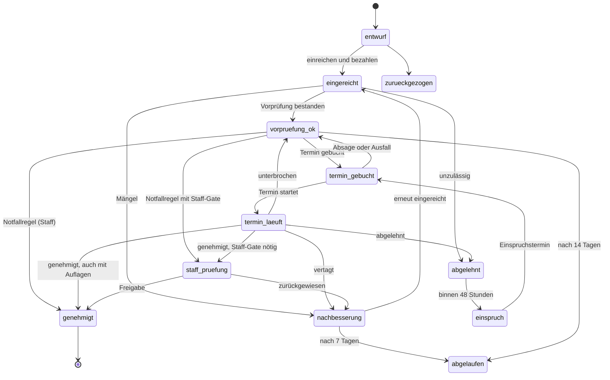

# Technik: Server-Ressource `ic_behoerden`

Version 0.1.0 · Lua 5.4 · FiveM (`fx_version 'cerulean'`, `lua54 'yes'`)

Dieses Dokument ist für alle, die die Ressource **einbauen, anpassen oder erweitern**. Was das System fachlich tut, steht im
[Konzept](KONZEPT.md). Die Reihenfolge für den Start auf dem Server steht in der [Umsetzung](UMSETZUNG.md).

> **Ehrlicher Stand:** Die gesamte Fachlogik, die Datenbankschicht, die Netzwerkschicht, der Client und die Oberfläche sind
> getestet (siehe [Abschnitt 12](#12-tests)). Die Anbindung an **ESX, QBCore, Qbox, ox_inventory, ox_target und die Banking-Ressourcen**
> ist gegen **Attrappen** geprüft, die ich aus den dokumentierten Schnittstellen gebaut habe. **Im Spiel ist die Ressource noch nicht gelaufen.**
> Plant einen Testtag auf einem Entwicklungsserver ein, bevor ihr live geht. Die Checkliste dafür steht in der [Umsetzung](UMSETZUNG.md).

---

## Inhalt

1. [Überblick](#1-überblick)
2. [Voraussetzungen und Installation](#2-voraussetzungen-und-installation)
3. [Dateien der Ressource](#3-dateien-der-ressource)
4. [Konfiguration](#4-konfiguration)
5. [Framework, Konto, Job, Inventar](#5-framework-konto-job-inventar)
6. [Hooks, Exporte und Ereignisse](#6-hooks-exporte-und-ereignisse)
7. [Datenbank und Datenmodell](#7-datenbank-und-datenmodell)
8. [Statusmodell und Fristen](#8-statusmodell-und-fristen)
9. [API-Referenz](#9-api-referenz)
10. [Sicherheitsmodell](#10-sicherheitsmodell)
11. [Betrieb](#11-betrieb)
12. [Tests](#12-tests)
13. [Erweitern](#13-erweitern)
14. [Bekannte Grenzen](#14-bekannte-grenzen)

---

## 1. Überblick

```
 Oberfläche (NUI, web/)           Client (client/main.lua)         Server
 ──────────────────────           ────────────────────────         ─────────────────────────────────────────────
 fetch('https://ic_behoerden/…') ► RegisterNUICallback ──────────► server/net.lua      Sitzung, Ort, Rate-Limit
 window.postMessage ◄──────────── SendNUIMessage                    server/api.lua      Rolle prüfen, Aufruf verteilen
                                                                    server/applications.lua  Anträge, Namen, Einladungen
                                                                    server/appointments.lua  Slots, Buchung, Termin, Sanktion
                                                                    server/register.lua      Eintragungen, Import
                                                                    server/staff.lua         Schlussprüfung, Eingriff, Kennzahlen
                                                                    server/store.lua         Speicher im RAM
                                                                    server/persist.lua ────► oxmysql ► MariaDB / MySQL
                                                                    server/bridge*.lua ────► ESX / QBCore / Qbox / ox_inventory …
```

**Leitgedanken**

- **Der Server entscheidet.** Die Oberfläche zeigt nur an. Der Client reicht Aufrufe unverändert durch. Wer jemand ist, wo er steht und
  welchen Job oder welches Recht er hat, ermittelt der Server bei **jedem** Aufruf selbst.
- **Alles im Speicher, Schreiben in die Datenbank.** Beim Start lädt `persist.lua` alle Tabellen in den Speicher. Jede Änderung geht über eine
  Warteschlange in die Datenbank. Da Lua pro Ressource nur einen Faden nutzt, kann es keine Wettläufe zwischen zwei Buchungen geben.
- **Die Fachlogik kennt kein Framework.** Sie spricht nur mit `IC.bridge`. Dadurch lässt sie sich komplett ohne FiveM testen.
- **Neue Felder brauchen keine Migration.** Jede Zeile liegt als JSON in der Spalte `data`. Index-Spalten gibt es nur für Abfragen im SQL-Client.

---

## 2. Voraussetzungen und Installation

### Voraussetzungen

| Was | Warum |
|-----|-------|
| **OneSync** (in aktuellen Artifacts Standard) | Der Server liest Spielerpositionen (`GetEntityCoords(GetPlayerPed(src))`) für die Ortsprüfung |
| **oxmysql** | Datenbank. Die Ressource lädt `@oxmysql/lib/MySQL.lua` |
| **MariaDB oder MySQL** mit `utf8mb4` | Umlaute und Anführungszeichen in Namen und Texten |
| Ein Framework: **es_extended** (Legacy 1.9 oder neuer), **qb-core** oder **qbx_core** | Charakter, Konto, Job. Ohne Framework läuft nur der Testmodus. |
| Optional: **ox_inventory**, **ox_target** | Gewerbeschein als Item, Zielauswahl statt Markern |

### Schritte

1. Ordner `resources/ic_behoerden` in euer `resources`-Verzeichnis kopieren. Es genügen: `fxmanifest.lua`, `config.lua`,
   `config_server.lua`, `client/`, `server/`, `shared/`, `sql/`, `web/` und `import/`. Der Ordner `tests/` wird vom Server nicht geladen und
   darf bleiben oder wegfallen.
2. `server.cfg`: Die Reihenfolge ist wichtig. Datenbank und Framework zuerst, dann die Ressource.
   ```cfg
   ensure oxmysql
   ensure es_extended        # oder qb-core / qbx_core
   ensure ox_inventory       # falls ihr es nutzt
   ensure ic_behoerden

   # Staff-Panel und Import
   add_ace group.admin ic_behoerden.staff allow
   ```
3. **Orte anpassen** (`config.lua`): Die Koordinaten sind Platzhalter beim Rathaus von Los Santos. Stellt euch im Spiel an den gewünschten Ort
   und tragt die Koordinaten ein.
4. **Beamte zuordnen** (`config_server.lua`, `Config.Officials.jobs`): Job-Name und Job-Stufe auf einen der vier Ränge abbilden.
5. **Items anlegen**: [Abschnitt 5.4](#54-items).
6. **Hooks anbinden**: Job, Gang und Firmenkonto bei einer Eintragung. [Abschnitt 6](#6-hooks-exporte-und-ereignisse).
7. Ressource starten. Die Tabellen legt sie selbst an (`sql/install.sql`, wiederholbar). Wer das nicht möchte, setzt
   `Config.AutoInstallSql = false` und spielt die Datei selbst ein.
8. In der Konsole prüfen: `icstatus` meldet Anzahl der Anträge, Einträge, Termine, Beamte im Dienst und das erkannte Framework.

Beim Start schreibt die Ressource `[ic_behoerden] Framework: esx` (oder `qb`, `qbox`) und `[ic_behoerden] Bereit: …`. Steht dort
`Läuft ohne Framework (Standalone)`, wurde kein Framework gefunden: Prüft die Reihenfolge in der `server.cfg` und `Config.Framework`.

---

## 3. Dateien der Ressource

| Datei | Aufgabe |
|-------|---------|
| `fxmanifest.lua` | Ladereihenfolge. `config_server.lua` und `server/` erreichen nie einen Client. |
| `config.lua` | **Client und Server:** Orte, Bedienung, Kartensymbol, optionale eigene Meldung |
| `config_server.lua` | **Nur Server:** Regeln, Gebühren, Rechtsformen, Branchen, Hooks, Webhooks, Framework |
| `shared/util.lua` | Hilfsfunktionen: Namens-Normalisierung, Levenshtein, UTF-8-sicheres Kürzen, Formate |
| `shared/rules.lua` | **Reine Regeln ohne Spielbezug:** Statusübergänge, Gebühren, Namensprüfung, Voraussetzungen, Slot-Berechnung, Entwurfsprüfung |
| `shared/protocol.lua` | Liste aller Aufrufe der Oberfläche und welche Gruppe sie ausführen darf |
| `server/store.lua` | Speicher: Tabellen, `put`, `del`, `list` |
| `server/persist.lua` | Datenbank: Warteschlange, Einfügen/Aktualisieren/Löschen, Laden, Installation |
| `server/bridge.lua` | Brücke (Basis): Ort, Nachrichten, Webhook, Inventar, Adapterwahl |
| `server/bridge_esx.lua` `bridge_qb.lua` `bridge_standalone.lua` | Adapter für das jeweilige Framework |
| `server/core.lua` | Zeit, Zähler, Einstellungen, Protokoll, Benachrichtigungen, Zahlungen, Webhooks, Hooks |
| `server/duty.lua` | Beamte im Dienst |
| `server/register.lua` | Eintragungen, Gewerbeschein, Statuswechsel, Bestandsimport |
| `server/applications.lua` | Anträge, Namensprüfung, Einladungen, Fristen, Änderungen, Register-Suche |
| `server/appointments.lua` | Strikes, Slots, Buchung, Check-in, Wartenummer, Termin führen und entscheiden, Sprechzeiten, Sanktionen |
| `server/staff.lua` | Schlussprüfung, Notfallregel, Kapazitäten, Sperrliste, Einstellungen, Register-Eingriff, Kennzahlen |
| `server/api.lua` | `bootstrap` und die zentrale Prüfung von Rolle und Sitzung (`IC.api.call`) |
| `server/net.lua` | Netzwerkereignisse, Sitzungen, Ortsprüfung, Rate-Limit, Login-Erkennung, Befehle |
| `server/main.lua` | Start, Exporte, Schreiben beim Stoppen |
| `client/main.lua` | Marker, Taste oder ox_target, NUI öffnen und schließen, Aufrufe weiterreichen, Einladung per Taste |
| `web/` | Oberfläche: HTML, CSS, JavaScript ohne Build-Schritt, lokale Schriften (`web/fonts/`) |
| `sql/install.sql` | Tabellen |
| `import/legacy.example.json` | Vorlage für den Bestandsimport |
| `tests/` | Lua-Tests ohne FiveM, Testserver und Browser-Szenario für die Oberfläche |

---

## 4. Konfiguration

Zwei Dateien. Die Trennung ist Absicht: Was in `config_server.lua` steht (Gebühren, Webhook-URLs, Hooks), erreicht nie einen Spieler.

### 4.1 `config.lua` (Client und Server)

| Schlüssel | Standard | Bedeutung |
|-----------|----------|-----------|
| `Config.City` | `'Los Santos'` | Name der Stadt in der Oberfläche und im Gewerbeschein |
| `Config.Locations.gewerbeamt` `.buergeramt` `.beamte` | Rathaus (Platzhalter) | Liste von `{ coords, radius, label }`. Eine Gruppe darf mehrere Orte haben. |
| `Config.Tolerance` | `3.0` | Meter, die ein Spieler über den Radius hinaus vom Terminal entfernt sein darf, bevor der Server die Sitzung beendet |
| `Config.Interact.mode` | `'marker'` | `'marker'` (Marker und Taste) oder `'target'` (ox_target) |
| `Config.Interact.key` | `38` (E) | Taste zum Öffnen |
| `Config.Interact.drawDistance` / `.marker` / `.helpText` | | Sichtweite, Aussehen des Markers, Hilfetext |
| `Config.Blips` | an | Kartensymbol am ersten Gewerbeamt-Ort |
| `Config.Notify` | `nil` | Eigene Meldungsfunktion `function(text, kind)` statt der Meldung am Bildschirmrand (Beispiel für ox_lib steht in der Datei) |

### 4.2 `config_server.lua` (nur Server)

| Schlüssel | Standard | Bedeutung |
|-----------|----------|-----------|
| `Config.Currency` | `'$'` | Währungszeichen |
| `Config.Framework` | `'auto'` | `'auto'`, `'esx'`, `'qb'`, `'qbox'`, `'standalone'` |
| `Config.AutoInstallSql` | `true` | Tabellen beim Start anlegen |
| `Config.Characters.idItem` | `nil` | Item, das als Personalausweis gilt. `nil`: kein Ausweis nötig |
| `Config.Characters.age` | `nil` | `function(src, charId)` liefert das IC-Alter. `nil`: aus dem Geburtsdatum des Frameworks |
| `Config.Characters.playHours` | `nil` | `function(src, charId)` liefert die Spielzeit in Stunden. **`nil`: die Mindestspielzeit wird nicht geprüft** |
| `Config.Rules.*` | siehe unten | Fristen, Limits, Strikes, Pauschale |
| `Config.Appointments.mode` | `'hybrid'` | `'hybrid'`, `'live'` (nur Beamte im Dienst) oder `'plan'` (nur Sprechzeiten) |
| `Config.Appointments.requireOfficials` | `true` | Kernregel „kein Beamter, kein Termin“. Der Staff kann sie im Panel umschalten. |
| `Config.Appointments.writtenProcedure` | `true` | Notfallregel: Entscheidung nach Aktenlage durch den Staff |
| `Config.Organizations.undergroundViaPortal` | `true` | Untergrund-Fraktionen melden eine legale Hülle an. `false`: komplett OOC. |
| `Config.Organizations.undergroundCap` | `8` | Höchstzahl Untergrund-Fraktionen |
| `Config.Decisions.fourEyes` | `false` | Vorgesehen für Phase 2, **ohne Wirkung** |
| `Config.Legacy` | 28 / 14 / `nil` | `confirmDays`, `remindAfterDays`, `restAfterDays` (nach so vielen Tagen wird ein unbestätigter Bestandseintrag „ruhend“, `nil` = nie) |
| `Config.Certificate.item` | `'gewerbeschein'` | Item-Name. Leer: es gibt keinen Gegenstand, nur den Schein in der Oberfläche |
| `Config.Treasury.account` | `'society_gov'` | Konto der Stadtkasse |
| `Config.Treasury.add` / `.remove` | `nil` | Eigene Konto-Anbindung `function(amount, reason)` und `function(amount, reason) return true end` |
| `Config.Officials.jobs` | `gov` | `{ [jobname] = { [stufe] = rang } }` |
| `Config.Officials.mustBeInOffice` | `true` | Tablet nur an den Schaltern |
| `Config.Officials.command` | `nil` | Befehl, der das Tablet überall öffnet (nur wenn `mustBeInOffice = false`) |
| `Config.Officials.desks` | `4` | Zahl der Schalter für die Aufrufanzeige |
| `Config.Ranks` / `Config.RankLabels` | | Rangfolge und Anzeigenamen |
| `Config.Staff.ace` / `.command` / `.importCommand` | `ic_behoerden.staff` / `icstaff` / `icimport` | ACE-Recht und Befehlsnamen |
| `Config.Webhooks.staff` / `.public` | leer | Discord-Webhooks |
| `Config.Standalone` | | Startguthaben, Alter, Spielzeit im Testmodus |
| `Config.LegalForms` | 8 Formen | `key`, `label`, `kind`, `minFounders`, `feeApply`, `feeRegister`, `capital`, `suffix`, `register`, `desc` |
| `Config.Branches` | 12 Branchen | `key`, `label`, `desc`, `needsProperty`, `authority`, `staffGate`, `cap`, `factor` |
| `Config.RegisterStart` | HRA 1000, HRB 300, VR 200, IG 0 | Zähler: Die nächste Eintragung bekommt Start + 1 |
| `Config.OrgRoles` / `Config.CompanyRoles` | | Erlaubte Rollen |
| `Config.AppointmentTypes` | 6 Arten | `key`, `label`, `minutes`, `minRank`, `needs`, `appKind`, `forStatus`, `entityNeeds`, `desc` |
| `Config.Checklists` | | Checkliste je Terminart. `optional = true`: gilt nur, wenn die Branche es verlangt |
| `Config.ConditionPresets`, `Config.ReasonPresets` | | Vorschläge für Auflagen und Begründungen im Tablet |
| `Config.Blacklist` | 11 Begriffe | Startwerte der Namenssperrliste (danach pflegt der Staff sie in der Datenbank) |
| `Config.Properties` | 6 Beispiele | Gewerbeverzeichnis. Eine eigene Immobilien-Ressource lässt sich über `Config.PropertyProvider` anbinden. |
| `Config.Hooks.*` | leer | siehe [Abschnitt 6](#6-hooks-exporte-und-ereignisse) |

**`Config.Rules`**

| Schlüssel | Standard | Bedeutung |
|-----------|---------:|-----------|
| `maxOpenApplications` | 2 | Offene Anträge je Charakter |
| `maxOpenAppointments` | 2 | Offene Termine je Charakter |
| `maxCompanies` / `maxOrgs` | 2 / 1 | Aktive Unternehmen als Inhaber oder Geschäftsführer, Organisationen als Gründer oder Vorstand |
| `nameReserveDays` | 7 | Namensreservierung |
| `fixDays` | 7 | Frist für Nachbesserung |
| `bookDays` | 14 | Frist zur Terminbuchung nach bestandener Vorprüfung |
| `objectionHours` | 48 | Einspruchsfrist nach Ablehnung |
| `cancelFreeMinutes` | 15 | Absage bis dahin vor Terminbeginn ohne Strike |
| `checkinBefore` / `checkinAfter` | 10 / 10 | Check-in-Fenster in Minuten |
| `liveHorizon` | 60 | Live-Termine: so viele Minuten im Voraus buchbar |
| `slotStep` / `leadMinutes` | 15 / 10 | Raster der Termine, frühestens so viele Minuten vor Beginn buchbar |
| `bookAheadDays` | 7 | Sprechzeiten und Buchungen so viele Tage im Voraus |
| `minAge` / `minPlayHours` | 18 / 10 | Voraussetzungen der Gründer |
| `strikeLimit` / `strikeDays` / `banDays` | 3 / 14 / 3 | Strikes bis zur Sperre, Gültigkeit eines Strikes, Dauer der Sperre |
| `escalateHours` | 72 | Ab hier ist ein Antrag eine Eskalation |
| `probationDays` | 14 | Probezeit bei Auflagen |
| `certDays` | 90 | Gültigkeit des Gewerbescheins (Anzeige, Verlängerung ist Phase 2) |
| `feeChange` / `feeDuplicate` | 200 / 100 | Gebühren |
| `officialPay` | 150 | Terminpauschale für den Beamten, aus der Stadtkasse |

**Zeiten und Zeitzone:** Alle Zeitstempel sind Millisekunden seit 1970. Wann ein „Tag“ beginnt (Terminübersicht, Sprechzeiten), entscheidet die
**Zeitzone des Servers**. Die Oberfläche zeigt Zeiten in der Zeitzone des Spielers. Stellt die Server-Zeitzone auf die eurer Spieler
(`TZ=Europe/Berlin`), sonst wirken Tagesgrenzen verschoben. Die Oberfläche übernimmt beim Öffnen die **Uhr des Servers**, damit Fristen und
„in 5 Minuten“ stimmen, auch wenn der Rechner des Spielers falsch geht.

---

## 5. Framework, Konto, Job, Inventar

Alles, was die Ressource vom Spiel braucht, läuft über `IC.bridge` (`server/bridge.lua`). Die Adapter liefern:

| Funktion | Bedeutung |
|----------|-----------|
| `detect()` | Läuft das Framework? |
| `charIdOf(src)`, `getChar(src)` | Charakter-ID und `{ charId, name, age, playHours, hasId }` |
| `getBank`, `addBank`, `removeBank` | Bankkonto des Spielers |
| `getOfficial(src)` | `{ rank, dienstnr }`, wenn der Job laut `Config.Officials.jobs` ein Beamter ist |
| `treasuryAdd`, `treasuryRemove` | Stadtkasse |
| `addItem`, `hasItem` | Inventar (nur ohne ox_inventory nötig) |

### 5.1 Was jeder Adapter benutzt

| | ESX (Legacy) | QBCore | Qbox |
|--|--------------|--------|------|
| Spieler | `ESX.GetPlayerFromId` | `QBCore.Functions.GetPlayer` | `exports.qbx_core:GetPlayer` |
| Charakter-ID | `xPlayer.identifier` | `PlayerData.citizenid` | `PlayerData.citizenid` |
| Name | `xPlayer.getName()` | `charinfo.firstname + lastname` | wie QBCore |
| Geburtsdatum | `xPlayer.get('dateofbirth')` | `charinfo.birthdate` | wie QBCore |
| Konto | `getAccount('bank')`, `add/removeAccountMoney` | `Functions.GetMoney/AddMoney/RemoveMoney('bank')` | wie QBCore |
| Job | `xPlayer.job.name` und `.grade` | `PlayerData.job.name` und `.grade.level` | wie QBCore |
| Stadtkasse | `esx_addonaccount` (`getSharedAccount`) | `qb-banking`, `Renewed-Banking` oder `qb-management` (in dieser Reihenfolge) | wie QBCore |
| Inventar ohne ox_inventory | `addInventoryItem` | `Functions.AddItem` | wie QBCore |
| Login-Ereignis | `esx:playerLoaded` | `QBCore:Server:PlayerLoaded` | `QBCore:Server:PlayerLoaded` |

Zusätzlich fragt die Ressource alle 10 Sekunden, welche Spieler einen geladenen Charakter haben. Das fängt Logins ab, falls ein Ereignis ausbleibt.

**Reihenfolge der Erkennung (`Config.Framework = 'auto'`):** Qbox, QBCore, ESX. Beim Start wartet die Ressource bis zu 20 Sekunden, bis eines davon läuft.

### 5.2 Alter, Spielzeit, Ausweis

- **Alter:** Standard ist das Geburtsdatum des Frameworks (Datum der echten Welt minus Geburtsdatum). Verstanden werden `TT/MM/JJJJ`, `TT.MM.JJJJ` und `JJJJ-MM-TT`.
  Fehlt das Datum, gilt der Charakter als zu jung, und die Konsole nennt es einmal. Abhilfe: `Config.Characters.age`.
- **Spielzeit:** Weder ESX noch QBCore kennen sie. **Ohne `Config.Characters.playHours` wird die Mindestspielzeit nicht geprüft.**
- **Ausweis:** Ohne `Config.Characters.idItem` ist die Voraussetzung immer erfüllt.

### 5.3 Beamte

```lua
Config.Officials = {
    jobs = {
        gov = { [0] = 'anwaerter', [1] = 'sachbearbeiter', [2] = 'amtsleiter', [3] = 'leitung' },
    },
}
```

Ein Beamter ist, wer den Job hat. **Im Dienst** ist er erst, wenn er das im Tablet einschaltet (Schalter wählen). Das ist unabhängig vom Dienststatus
eures Frameworks. Verliert er den Job, ist er sofort draußen. Beim Neustart der Ressource müssen alle Beamten den Dienst neu einschalten.
Im Testmodus (`standalone`) vergibt man Ränge per ACE: `add_ace identifier.license:… ic_behoerden.official.sachbearbeiter allow`.

### 5.4 Items

**ox_inventory** (`data/items.lua`):

```lua
['gewerbeschein'] = {
    label = 'Gewerbeschein',
    weight = 10,
    stack = false,
    close = true,
    description = 'Amtlicher Nachweis der Eintragung im Register der Stadt.',
},
```

**QBCore** (`shared/items.lua`):

```lua
gewerbeschein = { name = 'gewerbeschein', label = 'Gewerbeschein', weight = 10, type = 'item', image = 'gewerbeschein.png', unique = true, useable = false, shouldClose = true, description = 'Amtlicher Nachweis der Eintragung im Register der Stadt.' },
```

**ESX ohne ox_inventory** (Tabelle `items`, Spalten je nach Version): `INSERT INTO items (name, label, weight) VALUES ('gewerbeschein', 'Gewerbeschein', 1);`

Beim Ausstellen bekommt das Item Metadaten (`description`, `regNo`, `name`, `owner`, `kind`, `legalForm`). Ist der Inhaber offline oder das Inventar voll, merkt sich
die Ressource das und liefert den Schein beim nächsten Login nach. Ein Duplikat kostet `Config.Rules.feeDuplicate`.

### 5.5 Stadtkasse

Alle Gebühren gehen an die Stadtkasse, aus der die Terminpauschale bezahlt wird. Die Ressource führt zusätzlich eine eigene Zählung (Verwahrung und Kasse,
sichtbar im Staff-Panel). Ist die echte Kasse bei einer Pauschale nicht gedeckt, wird trotzdem gezahlt und im Protokoll vermerkt („Stadtkasse nicht gedeckt“).
Findet die Ressource keine Bank-Ressource, meldet sie es einmal in der Konsole. Mit `Config.Treasury.add` und `.remove` bindet ihr jede beliebige Banking-Ressource an.

---

## 6. Hooks, Exporte und Ereignisse

### 6.1 Hooks (`Config.Hooks`, alle optional, laufen auf dem Server)

| Hook | Wann | Parameter |
|------|------|-----------|
| `onApproved(entity, application)` | Eine Eintragung wurde vollzogen (nach IC-Genehmigung und gegebenenfalls Schlussprüfung) | Eintrag mit `entity.capital`, Antrag. `entity.ooc` nur, wenn der Staff die Fraktionsart kennt |
| `onStatusChanged(entity, old, new)` | Status einer Eintragung hat sich geändert (`aktiv`, `probezeit`, `ruhend`, `gesperrt`, `aufgeloest`) | |
| `onSanction(entity, sanction)` | Ein Beamter hat eine Maßnahme verhängt | `{ level, reason, amount, by, ts }` |
| `phoneMessage(charId, subject, text)` | Jede Benachrichtigung an einen Spieler, zusätzlich zur Meldung am Bildschirmrand | |

Fehler in einem Hook werden gemeldet und brechen nichts ab.

**Stammkapital (wichtig):** Bei GmbH und Stiftung zahlt der Antragsteller das Kapital beim Einreichen. Es bleibt in Verwahrung, die Ressource kennt eure Firmenkonten aber nicht.
`onApproved` bucht es auf das Konto des Unternehmens und **gibt dann `true` zurück**. Gibt der Hook etwas anderes zurück (oder fehlt er oder wirft einen Fehler),
**erstattet die Ressource das Kapital dem Antragsteller**. Es verschwindet nie.

```lua
onApproved = function(entity, application)
    -- Beispiel mit erfundenen Ressourcen (ersetzt sie durch eure):
    if entity.kind == 'unternehmen' then
        exports.mein_jobs:createJob(entity.regNo, entity.name)
        for _, m in ipairs(entity.members) do
            exports.mein_jobs:setJob(m.charId, entity.regNo, m.role == 'inhaber' and 'boss' or 'employee')
        end
    end
    -- Nur gesetzt, wenn der Staff die Fraktionsart kennt: Gang-Mechaniken freischalten
    if entity.ooc and entity.ooc.category == 'untergrund' then
        exports.mein_gangs:createGang(entity.regNo, entity.name)
    end
    if entity.capital then
        exports.mein_banking:addMoney(entity.regNo, entity.capital)
        return true      -- Kapital übernommen
    end
end,
```

### 6.2 Exporte (`exports.ic_behoerden:…`)

| Export | Ergebnis |
|--------|----------|
| `getEntity(regNo, withOoc)` | Registereintrag nach Nummer (`'HRB 0301'`, Leerzeichen und Groß/Klein egal), ohne OOC-Angaben, mit `withOoc = true` auch mit ihnen. `nil`, wenn es ihn nicht gibt. |
| `getEntitiesOf(charId)` | Alle nicht aufgelösten Einträge, an denen der Charakter beteiligt ist: `{ regNo, name, kind, legalForm, branch, status, role, share }` |
| `getMemberRole(charId, regNo)` | Rolle (`inhaber`, `geschaeftsfuehrer`, `gesellschafter`, `vorsitz`, `stellv`, `kasse`, `mitglied`) oder `nil` |
| `getOfficialsOnDuty()` | Liste der Beamten im Dienst: `{ charId, name, rank, desk }` |

### 6.3 Ereignisse (Server, `AddEventHandler(…)`)

| Ereignis | Parameter |
|----------|-----------|
| `ic_behoerden:entityCreated` | `entity` |
| `ic_behoerden:entityStatusChanged` | `entity, oldStatus, newStatus` |
| `ic_behoerden:entityImported` | `entity` |
| `ic_behoerden:applicationStatusChanged` | `application` |

### 6.4 Netzwerkereignisse (intern)

Nur zur Orientierung, andere Ressourcen sollen sie nicht auslösen.

| Richtung | Ereignis |
|----------|----------|
| Client → Server | `ic_behoerden:server:open (app, index)`, `:close`, `:call (reqId, name, data)`, `:inviteAnswer (accept)` |
| Server → Client | `ic_behoerden:client:open (app)`, `:close`, `:reply (reqId, result)`, `:notify (text, kind)`, `:invite (fromName)` |

### 6.5 Discord

`Config.Webhooks.staff`: neuer Antrag, Entscheidung, „Schlussprüfung wartet“, „Eskalation“ (jeweils einmal). `Config.Webhooks.public`: Neueintragung.
Die Meldungen enthalten nie OOC-Angaben.

---

## 7. Datenbank und Datenmodell

### 7.1 Tabellen (`sql/install.sql`)

| Tabelle | Inhalt | Index-Spalten |
|---------|--------|---------------|
| `ic_applications` | Anträge | `case_no` (eindeutig), `kind`, `status`, `applicant_char`, `name` |
| `ic_entities` | Eintragungen | `reg_no` (eindeutig), `kind`, `status`, `name` |
| `ic_appointments` | Termine | `status`, `booker_char`, `starts_at` |
| `ic_office_hours` | Sprechzeiten | `official_char`, `starts_at`, `ends_at` |
| `ic_blacklist` | Namenssperrliste | `term`, `reason` |
| `ic_settings` | Zähler, Schalter, Kapazitäten, Dienststatistik | |
| `ic_strikes` | Strikes | `char_id`, `ts` |
| `ic_chars` | Einstellungen je Charakter (Benachrichtigung bei Dienstbeginn, offene Gewerbescheine) | `notify_on_duty` |
| `ic_notices` | Benachrichtigungen, 30 Tage | `char_id`, `ts` |
| `ic_refunds` | Erstattungen für Spieler, die gerade offline sind | `char_id`, `ts` |
| `ic_audit` | Protokoll, nur anfügen | `ts`, `target` |

Jede Tabelle außer `ic_audit` hat `id` (Text) und `data` (JSON). Die **Index-Spalten werden bei jedem Schreiben neu gesetzt**, die Wahrheit steht in `data`.
Beim Start werden alle Zeilen in den Speicher geladen, vom Protokoll die letzten 500.

**Schreiben:** Jede Änderung wird als Anweisung mit Platzhaltern in eine Warteschlange gelegt und der Reihe nach ausgeführt. Nutzereingaben stehen nie im SQL-Text.
Beim Stoppen der Ressource geht alles Offene in **einer Transaktion** an die Datenbank. Ein Absturz des Servers kann die Änderungen der letzten Sekunden kosten (Warteschlange).

### 7.2 Antrag (`ic_applications.data`)

```
id "A-1"            caseNo "GA-2025-0001"      kind "unternehmen" | "fraktion"
status               siehe Abschnitt 8          restoreStatus  (Status vor einer Terminbuchung)
applicant { charId, name }
legalForm, branch, name (mit Rechtsformzusatz)
founders [ { charId, name, role, share, consent "self" | "ok" | "pending" } ]
property { mode "immobilie" | "mobil", id, label }
concept { idea, audience, offer, staff, hours }         # Unternehmen
statute { purpose, goals, admission }                   # Organisation
ooc { category "legal" | "untergrund", note, members }  # nur Staff
fees { apply, register, capital, paid, refunded, capitalTo }
events [ { ts, status, actor, actorKind, text, note } ] # Verlauf
decision { decision, reason, by, at, conditions[] }
reservedUntil, submittedAt, vorpruefungAt, objectionUntil, apptId, entityId, priority, escalationSent, conflicts[]
```

### 7.3 Eintragung (`ic_entities.data`)

```
id "E-1"   regNo "HRA 1001"   kind   legalForm   branch   name   status   hq   owner
members [ { charId, name, role, share } ]      founded, validUntil, memberCount
conditions [ { id, text, due, done } ]         history [ { ts, level, reason, by, amount } ]
capital, signedBy, applicationId, ooc, pendingChange
legacy, legacyConfirmed, legacyDue, legacyReminded, legacyRested, importRef, dissolvedAt
```

### 7.4 Termin (`ic_appointments.data`)

```
id "T-1"   typeId   start (ms)   minutes   status   source "live" | "plan"   note
booker, bookerName   attendees [ { charId, name, mandatory, checkedIn } ]
applicationId, entityId   official { id, name, ... }   startedAt   result { decision, reason, conditions, by, at }
```

### 7.5 Abfragen im SQL-Client

```sql
SELECT status, COUNT(*) FROM ic_applications GROUP BY status;
SELECT reg_no, name, status FROM ic_entities ORDER BY reg_no;
SELECT JSON_EXTRACT(data, '$.ooc.category') AS art, COUNT(*) FROM ic_entities GROUP BY art;
SELECT FROM_UNIXTIME(ts / 1000), actor, action, target, detail FROM ic_audit ORDER BY id DESC LIMIT 50;
```

**Ändern Sie Daten nicht im SQL-Client, solange die Ressource läuft.** Sie hält alles im Speicher und überschreibt bei der nächsten Änderung der Zeile. Notfalls: Ressource stoppen, ändern, starten.

---

## 8. Statusmodell und Fristen

### 8.1 Antrag



Dazu kommen `zurueckgezogen` (jederzeit vor der Entscheidung, mit Erstattung) und `abgelaufen` (Frist verstrichen, mit Erstattung).

Die erlaubten Übergänge stehen als Tabelle in `shared/rules.lua` (`R.TRANSITIONS`). Ein unzulässiger Wechsel wird abgelehnt und in der Konsole gemeldet.

| Frist | Wert | Folge |
|-------|------|-------|
| Nachbesserung | 7 Tage | Antrag läuft ab, verwahrte Beträge werden erstattet |
| Terminbuchung nach bestandener Vorprüfung | 14 Tage | wie oben |
| Einspruch nach Ablehnung | 48 Stunden | |
| Namensreservierung | 7 Tage ab jedem neuen offenen Status | |
| Name nach Ablehnung | 24 Stunden gesperrt | |
| Name nach Auflösung | 7 Tage gesperrt | |
| Eskalation | 72 Stunden nach bestandener Vorprüfung ohne Termin | Webhook, Anzeige im Staff-Panel |

Die Fristen prüft `IC.tick()`: vor jedem `bootstrap` und zusätzlich alle 30 Sekunden.

### 8.2 Termin

`gebucht → eingecheckt → aufgerufen → laeuft → abgeschlossen`, daneben `abgesagt`, `nicht_erschienen` (Strike) und `beamter_ausfall` (kein Strike, Vorrang beim Ersatztermin).

### 8.3 Eintragung

`aktiv`, `probezeit` (bei Auflagen), `ruhend`, `gesperrt`, `aufgeloest` (endgültig).

---

## 9. API-Referenz

Jeder Aufruf der Oberfläche hat einen Namen (`shared/protocol.lua`). Der Client reicht ihn unverändert weiter, `IC.api.call` verteilt ihn.
**Antwort:** immer eine Tabelle `{ ok = true, … }` oder `{ ok = false, error = 'Text für den Spieler' }`.

**Gruppen:** `any` (jeder mit geöffneter Oberfläche), `citizen` (Sitzung am Gewerbeamt oder Bürgeramt), `official` (Sitzung am Schalter und Beamten-Job), `staff` (Staff-Befehl und ACE-Recht).

| Aufruf | Gruppe | Parameter | Antwort (zusätzlich zu `ok`) |
|--------|--------|-----------|------------------------------|
| `bootstrap` | any | `app` | Alle Daten der Anwendung: `config`, `me`, `duty`, `board`, `myApplications`, `myEntities`, `myAppointments`, `myTicket`, `nearby`, `properties`, `eligibility`, `notices`, bei `beamte` zusätzlich `official`, `officialApps`, `officialAppts`, `queue`, `hours`, `register`, bei `staff` zusätzlich `staff` |
| `nameCheck` | any | `name`, `legalForm`, `ignoreAppId` | `ok` (Name zulässig), `normalized`, `display`, `issues[]` |
| `appSave` | citizen | `draft` | `id` |
| `appSubmit` | citizen | `draft` | `id`, `caseNo`, `paid`, `name`. Bei Fehlern `errors[]` mit `field` und `text` |
| `appWithdraw` | citizen | `id` | `deleted` oder `refunded` |
| `appObjection` | citizen | `id`, `text` | |
| `entityChange` | citizen | `id`, `type` (`name` oder `sitz`), `value` | `fee` |
| `entityDissolve` | citizen | `id` | |
| `entityDuplicate` | citizen | `id` | `fee` |
| `legacyConfirm` | citizen | `id` | |
| `registerSearch` | citizen | `q`, `kind`, `branch`, `status` | `rows[]` (öffentliche Sicht) |
| `founderInvite` / `founderStatus` / `founderCancel` | citizen | `charId` / – / `charId` | `statuses` (`pending`, `ok`, `no`, `expired`) |
| `slotsList` | citizen | `typeId`, `dayOffset`, `excludeApptId` | `days[]`, `slots[]`, `dayOffset`, `eligible`, `onDuty` |
| `apptBook` | citizen | `typeId`, `start`, `applicationId`, `entityId`, `attendees[]`, `note`, `rescheduleId` | `id` |
| `apptCancel` | citizen | `id` | `strike` |
| `apptCheckin` | citizen | `id` | `allIn` |
| `queueTake` / `queueLeave` | citizen | `typeId` (nur `beratung`) | `no`, `position`, `etaMin` |
| `notifyOnDuty` | citizen | `enabled` | `enabled` |
| `dutySet` | official | `state` (`on` oder `off`), `desk` | `state` |
| `appReview` | official | `id`, `result` (`ok`, `nachbesserung`, `abgelehnt`), `message` | |
| `conflictReport` | official | `id` | |
| `apptCall` / `apptStart` / `apptNoShow` | official | `id` (`excused` bei `apptNoShow`) | |
| `apptDecide` | official | `id`, `decision` (`genehmigt`, `auflagen`, `vertagt`, `abgelehnt`), `reason`, `conditions[]`, `checklist{}` | `outcome` (`eingetragen`, `staff`, …), `regNo`, `caseNo` |
| `queueNext` | official | | `no` |
| `hoursCreate` / `hoursDelete` | official | `start`, `finish` (oder `end`) / `id` | `id` |
| `sanctionIssue` | official | `entityId`, `level`, `reason`, `amount` | |
| `staffGate` | staff | `id`, `decision` (`freigeben` oder `zurueck`), `note` | |
| `staffWritten` | staff | `id`, `decision` (`genehmigt` oder `abgelehnt`), `reason` | |
| `staffCap` | staff | `key`, `value` | |
| `staffBlacklistAdd` / `staffBlacklistRemove` | staff | `term`, `reason` / `id` | |
| `staffSetting` | staff | `key`, `value` | |
| `staffEntityStatus` | staff | `id`, `status` (`aktiv`, `ruhend`, `gesperrt`, `aufgeloest`), `reason` | |

**Rollen und Sitzungen** prüft `IC.api.call` zentral. Gewerbeamt und Bürgeramt gehören zur selben Gruppe: Wer an einem der beiden Terminals sitzt, kann in der Oberfläche zum anderen wechseln.
Tablet und Staff-Panel sind getrennt.

---

## 10. Sicherheitsmodell

| Gefahr | Gegenmaßnahme |
|--------|---------------|
| Client behauptet Identität, Rolle oder Zustimmung | Der Server ermittelt Charakter, Beamten-Job und ACE-Recht bei jedem Aufruf selbst. Die Zustimmung eines Mitgründers entsteht nur durch dessen eigene Antwort (`:inviteAnswer`). |
| Aufrufe von der Ferne | Jede Sitzung ist an ein Terminal gebunden. Der Server prüft die Position bei jedem Aufruf (Radius + `Config.Tolerance`). Beim Entfernen, bei Tod oder Charakterwechsel endet die Sitzung. |
| Beamter verliert den Job oder das Recht | Wird bei jedem Aufruf neu geprüft, nicht beim Öffnen. |
| Manipulierte Preise, fremde Anträge, doppelte Gründer | Gebühren berechnet der Server, Besitz und Mitgliedschaft werden geprüft, Entwürfe werden zu festen Typen und Längen bereinigt. |
| SQL-Einschleusung | Alle Werte laufen über Platzhalter, Spaltennamen stehen nur im Code. |
| Flut von Aufrufen | Höchstens 40 Aufrufe in 10 Sekunden je Spieler, Daten bis 40.000 Zeichen. |
| OOC-Informationen bei Beamten (Metagaming) | Beamte und Bürger bekommen Einträge und Anträge **ohne** das Feld `ooc`. Nur das Staff-Panel enthält es. |
| Halbe Umlaute durch Kürzen | `U.ucut` kürzt nie mitten in einem UTF-8-Zeichen. |
| Geld verschwindet | Verwahrte Beträge und das Stammkapital gehen bei jedem Ausgang entweder an die Stadtkasse, an das Unternehmen oder zurück an den Antragsteller. Erstattungen für Offline-Spieler liegen in der Datenbank. |
| Befangenheit | Wer Gründer oder Mitglied eines Antrags ist, sieht ihn nicht zur Bearbeitung. Zusätzlich „Befangenheit melden“. |

---

## 11. Betrieb

### 11.1 Befehle

| Befehl | Wer | Wirkung |
|--------|-----|---------|
| `/icstaff` | Spieler mit ACE `ic_behoerden.staff` | Öffnet das Staff-Panel |
| `icimport` | Konsole oder ACE | Liest `import/legacy.json` und trägt den Bestand ein (siehe [Umsetzung](UMSETZUNG.md)) |
| `icstatus` | Konsole oder ACE | Zahlen zum Zustand |

Die Namen lassen sich in `Config.Staff` ändern.

### 11.2 Neustart und Absturz

- Der Zustand liegt in der Datenbank. Nach einem Neustart sind Anträge, Termine, Einträge, Reservierungen und Erstattungen wieder da.
- **Nicht gespeichert:** wer im Dienst ist, offene Mitgründer-Einladungen, die Wartenummern-Schlange. Beamte schalten den Dienst neu ein.
- Termine, die im Neustart ausfallen, behandelt der nächste Takt als „Beamten-Ausfall“ (kein Strike).

### 11.3 Leistung

Der Speicher bleibt klein (Hunderte Einträge, einige Tausend Anträge sind unkritisch). Pro Spieler mit geöffneter Oberfläche fallen wenige Aufrufe an.
Der Takt läuft alle 30 Sekunden. Beim Öffnen einer Anwendung berechnet der Server alles für diesen Spieler neu, das dauert Millisekunden.

### 11.4 Fehlersuche

| Beobachtung | Ursache |
|-------------|---------|
| `Läuft ohne Framework (Standalone)` | Framework startet nach der Ressource oder `Config.Framework` ist falsch. Reihenfolge in der `server.cfg`. |
| „Sie sind zu weit vom Terminal entfernt“ | Koordinaten in `config.lua` stimmen nicht, oder OneSync ist aus. Radius und `Config.Tolerance` erhöhen. |
| Alle Charaktere „zu jung“ | Geburtsdatum nicht lesbar. Konsolenhinweis beachten, `Config.Characters.age` setzen. |
| Mindestspielzeit wirkt nicht | Ohne `Config.Characters.playHours` wird sie nicht geprüft (so gewollt). |
| Kein Gewerbeschein im Inventar | Item fehlt im Inventar-System (Abschnitt 5.4). Der Schein bleibt vorgemerkt und kommt beim nächsten Login. |
| Gebühren erscheinen nicht auf dem Stadtkonto | Banking-Ressource nicht gefunden oder `Config.Treasury.account` falsch. Konsolenhinweis. Mit `Config.Treasury.add` selbst anbinden. |
| `Datenbankfehler` in der Konsole | Zugriff oder Zeichensatz der Datenbank. Die Tabellen brauchen `utf8mb4`. |
| Tablet lässt sich nicht öffnen | Spieler hat keinen Job aus `Config.Officials.jobs` (oder falsche Stufe). |
| Stammkapital „wurde erstattet“ | Der Hook `onApproved` gibt nicht `true` zurück (Abschnitt 6.1). |

---

## 12. Tests

Alle Tests laufen **ohne FiveM**. Aus dem Ordner `resources/ic_behoerden`:

```bash
lua5.4 tests/run.lua                  # 116 Tests: Logik, Datenbankschicht, Netzwerk, Adapter, Client
node tests/ui/e2e-server.js           # Oberfläche im Browser gegen die echte Serverlogik (Node, Playwright, Lua 5.4)
node tests/ui/preview/ablauf.js       # Vorschau (Mock-Backend): Ablauf, dazu organisation-und-staff.js, mobil.js, dunkel.js, nui.js
```

Oder im Hauptordner mit `npm test` (benötigt `npm install` für Playwright). Die Links der Dokumentation prüft `npm run check:docs`.

| Datei | Prüft |
|-------|-------|
| `tests/test_util.lua` | Namens-Normalisierung (identisch zur Oberfläche, mit Fixture-Abgleich), Levenshtein, UTF-8-sicheres Kürzen |
| `tests/test_rules.lua` | Statusübergänge, Gebühren, Namensprüfung, Voraussetzungen, Slot-Berechnung, Entwurfsprüfung |
| `tests/test_flows.lua` | Gründung vom Antrag bis zur Eintragung, Termine, Ausfälle, Strikes, Notfallregel, Einspruch, Sanktionen, Rollen, Manipulation, Bestandsschutz, Import, Kapital, Webhooks |
| `tests/test_persist.lua` | SQL mit Platzhaltern, Reihenfolge der Warteschlange, Schreiben beim Stoppen |
| `tests/test_net.lua` | Sitzungen, Ortsprüfung, Rate-Limit, Staff-Recht, Einladungen, Login, Abmeldung, Befehle |
| `tests/test_bridge.lua` | Adapter für ESX, QBCore, Qbox, Standalone mit Attrappen, Frameworkwahl, Alter, Items |
| `tests/test_client.lua` | Marker, Taste, Öffnen, Rückrufe und Zeitüberschreitung, Schließen, Meldungen, Einladung, ox_target |
| `tests/ui/preview/` | Die Vorschau mit ihrem Mock-Backend: kompletter Ablauf, Organisation mit Staff-Freigabe, Mobilansicht, dunkles Thema, NUI-Modus |
| `tests/ui/` | Testserver (`server.lua`) und Browser-Szenario mit acht Spielern: Gründung eines Einzelunternehmens und eines Vereins mit Einladungen, Termine, Entscheidung, Schlussprüfung, Eskalation, Sanktion, Sperrliste, Register-Eingriff, Ort- und Rollenprüfung, Rundgang durch alle Ansichten |

Zusätzlich wurde die Datenbankschicht einmalig gegen eine **echte MariaDB** geprüft (Umlaute, Anführungszeichen, Semikolon und `DROP TABLE` im Freitext kamen unverändert zurück).

**Was die Tests nicht abdecken:** das tatsächliche Verhalten von ESX, QBCore, Qbox, ox_inventory, ox_target, Banking-Ressourcen und oxmysql im Spiel (nur Attrappen
nach der dokumentierten Schnittstelle), Optik und Bedienung im Spiel-Browser (NUI), Lastverhalten.

---

## 13. Erweitern

| Ziel | Wo |
|------|----|
| Neue Branche | `Config.Branches` um einen Eintrag ergänzen. Fertig. |
| Neue Rechtsform | `Config.LegalForms`. Neues Register-Kürzel: `Config.RegisterStart` ergänzen. |
| Neue Terminart | `Config.AppointmentTypes` und `Config.Checklists`. Bei neuer Logik zur Entscheidung: `server/appointments.lua`, Funktion `P.decide`. |
| Neue Regel | In `shared/rules.lua` (rein, ohne Spielbezug), dazu ein Test in `tests/test_rules.lua`. |
| Neuer Aufruf der Oberfläche | `shared/protocol.lua` (Name und Gruppe), Handler in `server/api.lua`, Test in `tests/test_flows.lua`, Gegenstück im Vorschau-Mock `web/js/mock.js`. Der Test „jeder Aufruf der Oberfläche ist bekannt“ prüft die Liste. |
| Anderes Framework | Neuer Adapter nach dem Muster von `server/bridge_esx.lua`: `B.adapters.name = A` mit den Funktionen aus Abschnitt 5, dazu `FRAMEWORK_RESOURCE` und `B.ORDER` in `server/bridge.lua`. |
| Andere Sprache | Alle Texte stehen deutsch im Code. Die Oberfläche in `web/js/labels.js` und den Views, Fehlertexte in `server/*.lua`. |
| Vorschau neu bauen | `node tools/build-preview.js` (Vorschau-Datei) oder `--fragment` (zum Veröffentlichen). Schriften erneuern: `node tools/fetch-fonts.js`. |

---

## 14. Bekannte Grenzen

- **Nicht im Spiel getestet** (siehe Kopf dieses Dokuments).
- **Phase 2 (nicht enthalten):** Vier-Augen-Prinzip, Verlängerung des Gewerbescheins (die Gültigkeit wird nur angezeigt), Verordnungen der Behördenleitung,
  „Alt-Hinweis“ (Verknüpfung mehrerer Charaktere eines Spielers), eigene Kacheln für Vorprüfungs-Durchlaufzeit und Eskalationsquote.
- **Eine Instanz:** Die Ressource hält den Zustand im Speicher und ist für einen Spieleserver gedacht. Mehrere Server mit einer Datenbank sind nicht vorgesehen.
- **Zeitzone:** siehe Abschnitt 4.
- **Quoten im Staff-Panel** schwanken bei wenigen Vorgängen stark.
- **Telefon und Firmenkonto** hängen an euren Ressourcen (Hooks). Ohne Anbindung kommt die Nachricht als Meldung, und das Kapital geht zurück an den Antragsteller.
